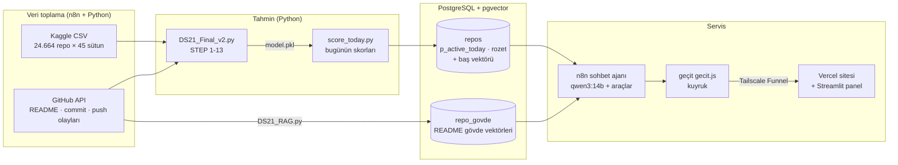
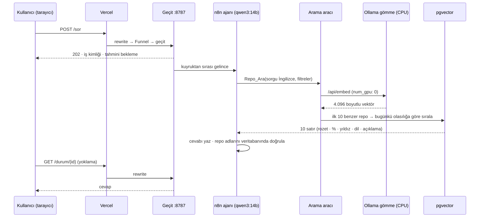
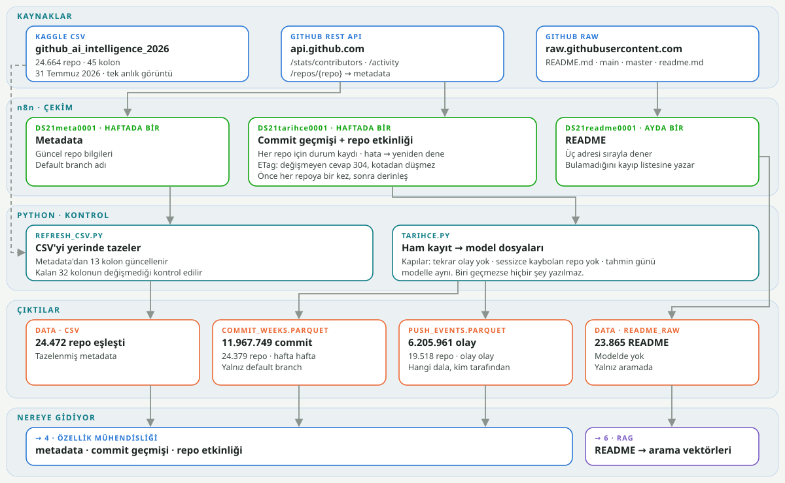
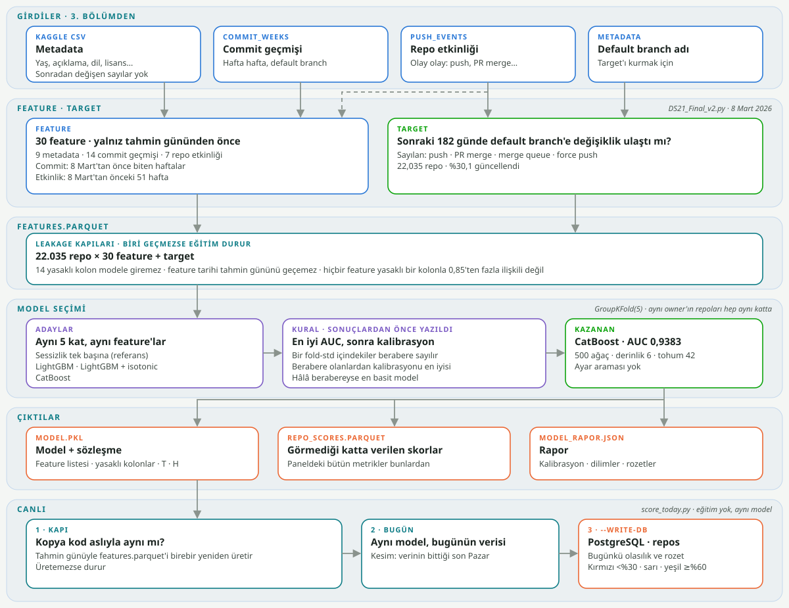
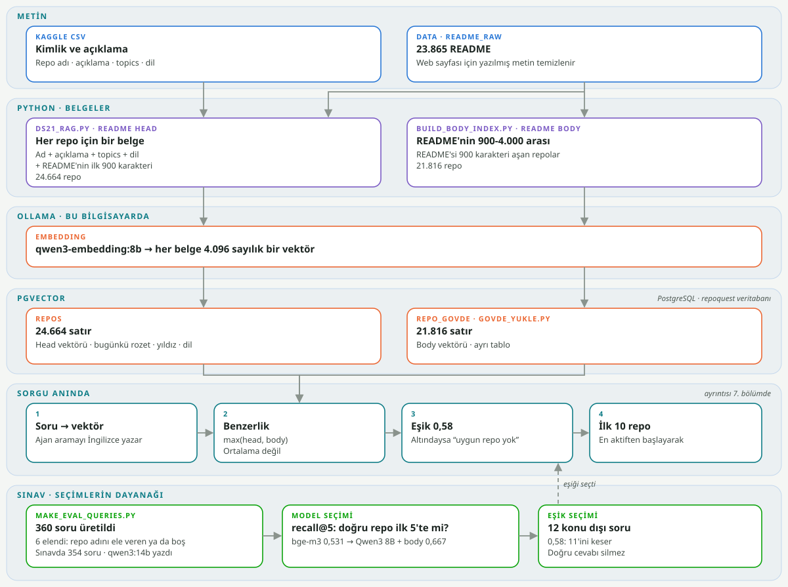
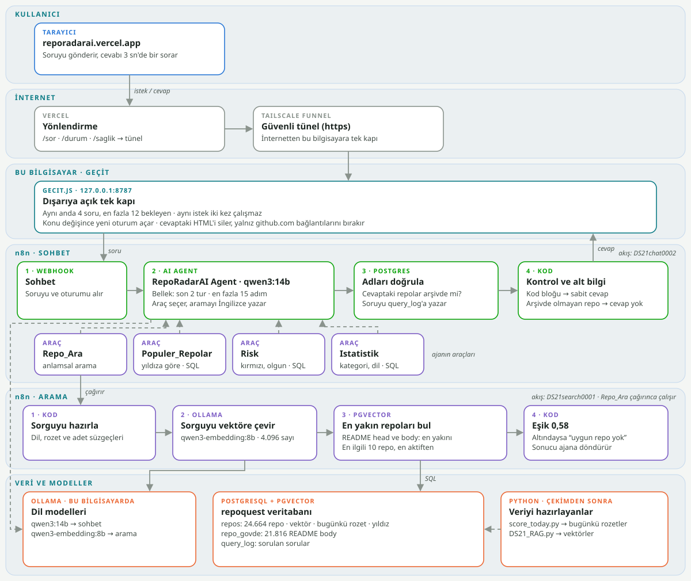
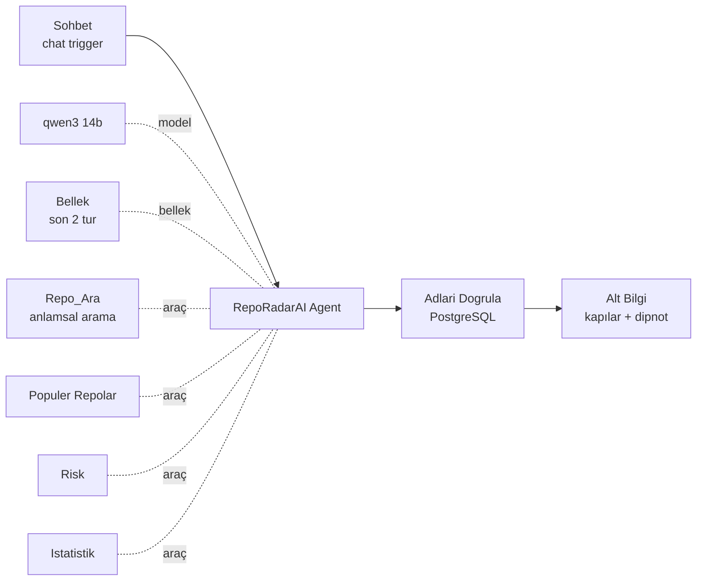

# RepoRadarAI

Terk edilmeyecek yapay zekâ araçlarını öneren RAG tabanlı öneri sistemi.

## Bu repoda ne var, ne yok

| | |
|---|---|
| **Kod** | Eğitim zinciri (`DS21_Final_v2.py`), canlı skorlama (`score_today.py`), RAG (`DS21_RAG.py`), veri tazeleme betikleri, `tools/`, sunum paneli (`panel_v2/`), n8n akışlarının dışa aktarımları (`n8n/`) ve geçit (`web/gecit.js`) |
| **Veri** | Repoda yok. Kaggle'dan indirilir: [AI Open Source Projects & Developer Tools - GitHub](https://www.kaggle.com/datasets/mansiaggarwal88/github-ai-repository-intelligence-dataset). Dosya `Data/github_ai_intelligence_2026.csv` olarak kaydedilir. Projede kullanılan sürüm 31.07.2026 anlık görüntüsüdür; 13 sütununu `refresh_csv.py` tazeler ([2.4](#24-csv-tazeleme-neden-45-sütunun-yalnız-13ü)). |
| **Artefaktlar** (`outputs/`) | Repoda yok, toplam yaklaşık 940 MB. Zincir yerelde üretir; liste [13.2](#132-artefaktlar-outputs)'de. |
| **Canlı site** | Repoda yok. Vercel sayfası (`site/`) ve tünel betikleri kişiye özel adresler taşıdığı için dışarıda bırakıldı; site şu an kapalı. [Bölüm 1](#1-sistem-mimarisi) servis katmanını kurulduğu hâliyle anlatır. |
| **Gizli bilgiler** | Repoda yok. Veritabanı parolası `DS21_PG_PASSWORD`, GitHub jetonu `GITHUB_TOKEN` ortam değişkeninden okunur ([11.2](#112-ortam-değişkenleri)); n8n kimlik bilgileri n8n'in kendi içinde durur. |

---

## İçindekiler

0. [Özet](#0-özet)
1. [Sistem mimarisi](#1-sistem-mimarisi)
2. [Veri](#2-veri)
3. [Sızıntı denetimi](#3-sızıntı-denetimi)
4. [Hedef tanımı](#4-hedef-tanımı)
5. [Özellik mühendisliği](#5-özellik-mühendisliği)
6. [Modelleme](#6-modelleme)
7. [Yorumlanabilirlik](#7-yorumlanabilirlik)
8. [Canlı skorlama](#8-canlı-skorlama)
9. [RAG](#9-rag)
10. [Sohbet ajanı ve servis katmanı](#10-sohbet-ajanı-ve-servis-katmanı)
11. [Operasyon](#11-operasyon)
12. [Sınırlar ve bilinen kusurlar](#12-sınırlar-ve-bilinen-kusurlar)
13. [Ekler](#13-ekler)

---

## 0. Özet

### Problem

GitHub'daki yapay zekâ araçlarının önemli bir kısmı kısa sürede bakımsız kalıyor. Bir kullanıcı
ihtiyacına uyan aracı bulduğunda, o aracın önümüzdeki aylarda güncelleme alıp almayacağını
bilemiyor. Yıldız sayısı bu soruya cevap vermiyor: yıldız birikimli bir sayıdır ve terk edilmiş
bir repoda da düşmez.

RepoRadarAI iki soruyu birlikte cevaplar:

1. **Hangi repolar bu ihtiyaca uyuyor?** (anlamsal arama, RAG)
2. **Bunlardan hangisi önümüzdeki 6 ayda güncelleme alacak?** (tahmin modeli)

Kullanıcı soruyu doğal dille sorar. Sistem ilgili repoları bulur, güncelleme alma olasılığına
göre sıralar ve her repoya bir rozet verir.

### Tahmin modeli

| | |
|---|---|
| Hedef (`etiket_c`) | T sonrası 182 gün içinde reponun **varsayılan dalına** en az bir değişiklik ulaşıyor mu? Bakım botlarının birleştirdiği değişiklikler sayılır; release ve tag sayılmaz. (`DS21_Final_v2.py:749-761`) |
| Kesim tarihi T / ufuk H | 2026-03-08 (Pazar) / 182 gün |
| Model çerçevesi | 22.035 repo · pozitif oranı %30,07 |
| Model | CatBoost, kalibrasyonsuz · 30 özellik |
| Doğrulama | GroupKFold(owner, 5 kat), out-of-fold |
| AUC / PR-AUC / Brier | **0,9383** (±0,001) / 0,8951 / 0,0837 |
| Taban model (baseline) | Tek özellikli sessizlik modeli (son commit'ten beri geçen süre): AUC 0,9303 · PR-AUC 0,8689 |

Taban modelin AUC'si bu kadar yüksek, çünkü bir reponun güncellenip güncellenmeyeceğinin en güçlü
işareti ne kadar süredir sessiz olduğu. Modelin katkısı bu yüzden tüm kümede küçük (+0,008 AUC),
ama sessizliğin cevap veremediği dilimlerde büyük. Örneğin 2 yıldan uzun süredir sessiz repolarda
AUC 0,595'ten 0,729'a çıkıyor (`model_rapor.json → slices`). Ayrıntılar
[Bölüm 6](#6-modelleme)'da.

**Rozetler** tahmin edilen olasılıktan türetilir. Out-of-fold tahminlerde gerçekleşen
güncelleme oranları şöyle:

| Rozet | Eşik | Repo (OOF) | Gerçekte güncelleme alan |
|---|---|---|---|
| 🟢 GREEN | p ≥ 0,60 | 5.296 | %88,4 |
| 🟡 AMBER | 0,30 ≤ p < 0,60 | 2.015 | %44,0 |
| 🔴 RED | p < 0,30 | 14.724 | %7,2 |

Kaynak: `model_rapor.json → badges`. Canlı sistemde tüm külliyat bugünün verisiyle yeniden
skorlanır (`score_today.py`, 2026-09-06 kesimi): 🔴 16.025 · 🟡 2.417 · 🟢 5.937 ·
VERI_YOK 285 (bkz. [Bölüm 8](#8-canlı-skorlama)).

### Anlamsal arama (RAG)

Her repo için bir belge üretilir. Belge sırasıyla şunları içerir: repo adı, GitHub açıklaması
(en fazla 400 karakter), topics, dil ve README'nin ilk 900 karakteri
(`DS21_RAG.py:162 build_primary_doc`). Belgeler
`qwen3-embedding:8b` ile 4.096 boyutlu vektörlere dönüştürülüp PostgreSQL + pgvector'de
tutulur. README'nin gövdesi ayrı bir vektör olarak eklenir ve skor, baş ile gövde
benzerliklerinden büyük olanıdır.

Değerlendirme 354 soruluk sabit bir sınavla yapıldı: her soru tek bir repoyu tarif ediyor,
repo adı vermiyor. Tüm 24.664 belge üzerinde ölçülen sonuçlar:

| Belge | recall@1 | recall@5 | recall@10 |
|---|---|---|---|
| Yalnız baş | 0,4576 | 0,6356 | 0,7373 |
| Baş + gövde (sevk edilen) | 0,4859 | **0,6667** | 0,7316 |


### İki yarının birleşmesi

Arama benzerliğe göre ilk 10 repoyu getirir. Bu 10 repo daha sonra modelin bugünkü güncelleme
olasılığına göre yeniden sıralanır. Yani **ilgililiği arama, sıralamayı model belirler.**
Kullanıcıya bu işi n8n'de çalışan bir sohbet ajanı (`qwen3:14b`, yerel) sunar. Ajan araç
çağırarak veritabanını sorgular. Cevaptaki her repo adı, gösterilmeden önce veritabanında
doğrulanır.

### Sistem, tek bakışta



Bileşenlerin ayrıntısı ve neden bu şekilde ayrıldıkları [Bölüm 1](#1-sistem-mimarisi)'de.

## 1. Sistem mimarisi

Sistem iki zaman ölçeğinde çalışır:

- **Çevrimdışı hat** (haftalık/aylık): veri çekilir, model eğitilir, bütün külliyat skorlanır,
  sonuçlar ve vektörler veritabanına yazılır.
- **Çevrimiçi hat** (soru başına): kullanıcının sorusu ajana ulaşır, ajan veritabanını sorgular,
  cevap sayfaya döner.

İki hat yalnız veritabanında buluşur. Çevrimiçi hatta hiçbir model eğitilmez ve hiçbir skor
hesaplanmaz. Soru anında yapılan tek hesap, sorunun vektöre çevrilmesidir.

### 1.1 Bileşenler

| Bileşen | Nerede çalışır | Görevi | Kaynak |
|---|---|---|---|
| Veri çekim akışları (3) | n8n | GitHub API'den metadata (haftalık), README (aylık), commit ve push geçmişi (haftalık) | `n8n/RepoRadarAI- Metadata.json` · `RepoRadarAI Readme.json` · `RepoRadarAI - Commit _ Push (Tarihçe).json` |
| Eğitim zinciri | Python | Sızıntı denetimi, hedef, özellikler, model, değerlendirme (STEP 1-13) → `model.pkl` | `DS21_Final_v2.py` |
| Canlı skorlama | Python | Bütün külliyatı bugünün verisiyle skorlar, rozetleri veritabanına yazar | `score_today.py` |
| Belge ve vektör üretimi | Python + Ollama | Repo belgelerini kurar, `qwen3-embedding:8b` ile gömer, veritabanına yükler | `DS21_RAG.py` · `tools/govde_yukle.py` |
| Veritabanı | Docker: `ds21-pgvector` (PostgreSQL 17 + pgvector) | Skorlar, rozetler, vektörler ve sorgu kaydı | `requirements.txt` başlığı |
| Sohbet ajanı | n8n: `DS21chat0002` | `qwen3:14b` ile soruyu anlar, araç çağırır, cevabı yazar | `n8n/RepoRadarAI Agent.json` |
| Anlamsal arama aracı | n8n: `DS21search0001` | Sorguyu vektöre çevirir, pgvector'de arar, sonucu sıralar | `n8n/RepoRadarAI - Anlamsal Arama.json` |
| Dil modelleri | Ollama (yerel, RTX 4060 Ti 16 GB) | `qwen3:14b` sohbet · `qwen3-embedding:8b` gömme | `gecit.js:8-13` |
| Geçit | Node.js | Dışarıya açık tek uç: kuyruk, eşzamanlılık sınırı, tekrar koruması | `web/gecit.js` |
| Tünel | Tailscale Funnel | Geçidi (443) ve paneli (8443) internete açar | `gecit.bat` |
| Site | Vercel (statik) | Paneli tam ekran gösterir, sohbet balonunu taşır | `site/index.html` · `site/vercel.json` |
| Sunum paneli | Streamlit | 8 bölümlük analiz paneli | `panel_v2/` |

**Portlar** (hepsi aynı makinede):

| Port | Servis | Dışarıya açık mı |
|---|---|---|
| 5678 | n8n | Hayır. Funnel'a verilmez. |
| 5433 → 5432 | `ds21-pgvector` | Hayır |
| 11434 | Ollama | Hayır |
| 8787 | Geçit | Evet, Funnel 443 üzerinden |
| 8611 | Panel | Evet, Funnel 8443 üzerinden |

### 1.2 Bir sorunun yolu



Tarayıcı geçide doğrudan bağlanmaz, Vercel'in `rewrites` kuralları üzerinden bağlanır
(`site/vercel.json`). Böylece sayfa ve API aynı kökenden gelir, CORS gerekmez. Cevap uzun
sürdüğü için istek bekletilmez. Geçit hemen bir iş kimliği döner ve sayfa sonucu yoklar.
Tek bir sorunun ölçülen süresi 42 sn'dir (`gecit.js:8-13`, 11.09). Modeller soğukken ilk
soru daha uzun sürer.

### 1.3 Tasarım kararları

**Neden ayrı bir vektör veritabanı değil, PostgreSQL + pgvector?**
Ajanın dört aracından yalnız biri vektör kullanır. Diğer üçü düz SQL'dir: yıldıza göre
sıralama, riskli olgun repolar ve kategoriye göre sayım. Bu üç aracın ihtiyaç duyduğu yıldız,
rozet, kategori ve olasılık sütunları vektörle **aynı satırda** durur (`repos` tablosu). Ayrı bir
vektör deposunda bu sorular ya cevaplanamazdı ya da iki sistemden çekilip n8n içinde
birleştirilmesi gerekirdi. Arama aracı da tek sorguda hem benzerliğe göre arar hem
`badge_today` filtresi uygular hem de satırı biçimlendirir
(`RepoRadarAI - Anlamsal Arama.json → Vektoru Hazirla`).

**Neden vektör indeksi (HNSW) yok?**
pgvector 4.096 boyutlu vektörü depolar ve arar, ama HNSW ve IVFFlat indeksleri en fazla
2.000 boyutu kabul eder. Arama bu yüzden tam taramadır. Isınmış veritabanında süresi
~0,3-0,9 sn'dir; sohbet modelinin cevap yazma süresinin yanında küçük kalır. Külliyat büyürse
ilk adım ayrı bir vektör veritabanı değildir: `qwen3-embedding` MRL ile eğitildiği için vektör
1.024 boyuta kırpılıp indekslenebilir.
*(Kırpma deneyinin sayıları [Bölüm 9](#9-rag)'da.)*

**Neden veritabanı ayrı bir konteyner?**
Aynı makinede başka projelerin de PostgreSQL'i var. `ds21-pgvector`, pgvector eklentili ayrı bir
imajdır ve ayrı bir portta (5433) çalışır. n8n ile aynı Docker ağındadır (`n8n_default`), n8n ona
konteyner adıyla bağlanır. Yeniden başlatma politikası `unless-stopped`: makine yeniden
başladığında n8n kendiliğinden ayağa kalkıyordu, veritabanı kalkmıyordu ve sohbet sessizce
boş cevap veriyordu (`requirements.txt` başlığı).

**Neden bir geçit var?**
Tailscale Funnel bir **port** yayınlar, bir yol değil. n8n'in portunu açmak, aynı n8n'de çalışan
başka projelerin webhook'larını da internete açardı. Geçit dışarıya bakan tek yüzeydir ve yalnız
üç yol bilir: `/sor`, `/durum/{id}`, `/saglik` (`gecit.js:1-6`). İkinci görevi GPU'yu korumaktır.
Ölçüme göre tek GPU dört eşzamanlı istekte doyuyor. Geçit en fazla 4 isteği aynı anda çalıştırır,
12'ye kadar isteği kuyrukta bekletir ve bir ziyaretçinin aynı anda tek sorusu olabilir.
Sayfa bir isteği yeniden gönderdiğinde aynı `istekId` kullanılır. Böylece bağlantı hatasından sonra
yapılan tekrar, aynı soruyu iki kez çalıştırmaz (`gecit.js:54-61`).

**Neden sorgu gömmesi CPU'da?**
`qwen3-embedding:8b` ve `qwen3:14b` 16 GB'lık GPU'ya birlikte sığmaz. İkisi de GPU'da olsaydı
her anlamsal soruda biri boşaltılıp diğeri yüklenirdi. Tek bir kısa sorguyu gömmek işlem
gücü gerektiren bir iş değildir; toplu gömmede GPU'nun avantajı vardır, tek sorguda yoktur.
Arama aracı Ollama'ya `num_gpu: 0` gönderir, gömme modeli sistem belleğinde çalışır ve sohbet
modeli GPU'dan hiç boşaltılmaz. Külliyatın toplu gömmesi çevrimdışı yapılır.

**Neden panel veritabanına bağlanmıyor?**
Panel yalnız `outputs/` altındaki artefaktları okur: `model_rapor.json`, `repo_scores.parquet`,
`scores_today.parquet`, `features.parquet` (`panel_v2/veri.py:195-225`). Bu belgedeki sayılar da
aynı dosyalardan okunduğu için panel ve belge birbiriyle çelişmez. Veritabanı çalışmasa bile
panel açılır.

**Neden model bulutta değil, yerelde?**
Dil modelleri kendi GPU'mda çalışıyor: soru başına ücret yok, veri dışarı çıkmıyor. Bedeli
kapasite sınırı: aynı anda 4 istek. Site statik olduğu için Vercel'de barındırılıyor; dinamik
kısım rewrite ve tünel üzerinden makineye yönleniyor.


## 2. Veri

Projenin çıkış noktası tek bir tablodur: Kaggle'daki *GitHub AI Repository Intelligence 2026*
veri seti. Bu tablo repoların bir **anlık görüntüsüdür**. Bir reponun bugün ne olduğunu gösterir,
zaman içinde nasıl davrandığını göstermez. Terk tahmini ise tam olarak bu davranışa ihtiyaç duyar.
Bu yüzden tablo üç ayrı GitHub çekimiyle zenginleştirildi.

### 2.1 Temel kaynak: Kaggle CSV

| | |
|---|---|
| Dosya | `Data/github_ai_intelligence_2026.csv` |
| Boyut | 24.664 repo × 45 sütun |
| Anlık görüntü | 2026-07-31 (en büyük `pushed_at`). Saniye düzeyinde 13:01:21 UTC: `repo_age_days` sütunu API'deki tam `created_at` damgalarıyla çakıştırılarak bulundu. |
| Tekrar | `full_name` tekrarı 0 · fork 0 (`fork` her satırda FALSE) |
| Eksik değer | yalnız `description` 148 · `language` 1.892 · `homepage` 12.749 |
| Tarih biçimi | `gg/aa/yy`. Metin olarak sıralanınca yanlış min/max verir; kod her yerde `format='%d/%m/%y'` ile okur. |
| Aralık | `created_at` 2008-05-05 → 2026-07-29 |


### 2.2 Örneklem: rastgele bir GitHub örneği değil

Veri seti GitHub'ın rastgele bir örneği değildir. Bunu gösteren iki ölçüm var:

- **Alt sınır:** Anlık görüntüde en az 10 yıldızlı repolar var. Hiç görünürlük kazanmamış
  projeler veri setinde yok.
- **100 yıldızda kırılma:** 90-99 yıldız aralığında 1.342 repo varken 100-109 aralığında yalnız
  190 repo var. Bu, yıldız başına yoğunlukta yaklaşık 7 katlık bir düşüş demek. Yıldız dağılımı
  bir güç yasasına uyar; doğal bir dağılım 100'de böyle kırılmaz. Kırılma, veri setinin bir
  kota ya da eşikle toplandığını gösteriyor.

Toplamanın konu filtresiyle yapıldığını gösteren işaretler de var. Tanınmış bazı araçların
kendisi veri setinde yok, uydu repoları var (örneğin `SYSTRAN/faster-whisper` var,
`openai/whisper` yok). Sonuç olarak modelin evreni **"belli bir görünürlüğe ulaşmış, yapay
zekâ konulu, derlenmiş bir repo havuzu"**dur. Bulgular bütün GitHub'a genellenmez.


### 2.3 Zenginleştirme: üç GitHub çekimi



*Şema: panelin 3. bölümü. `tools/mimari_svg.py` ile `panel_v2/grafik.py`'den üretilir; sayılar artefaktlardan okunur.*

| Çekim | API ucu | Ne getirir | Kapsam | Kullanıldığı yer |
|---|---|---|---|---|
| Commit geçmişi | `/stats/contributors` | Katkıcı başına haftalık commit sayısı | 24.379 repo · 799.003 repo-hafta satırı · 11.967.749 commit | Özellikler (`cm_*`) |
| Etkinlik (push) akışı | `/activity` | Her push, PR birleştirme, dal açma/silme, force push olayı; hangi dala gittiği | 6.205.961 olay · 19.518 repo · 2023-03-07 → 2026-09-10 | **Hedef** (`etiket_c`) ve özellikler (`pa_*`) |
| README | `raw.githubusercontent.com` | Ham README metni | 23.865 repo (404: 697 · hata: 98) | RAG belgeleri |

Bu üçünden en önemlisi etkinlik akışıdır, çünkü hedef bu akıştan kurulur. Commit geçmişi
"kim, hangi hafta, kaç commit" sorusunu cevaplar ama commit'in hangi dala gittiğini söylemez.
Etkinlik akışı bunu söyler. Bir değişikliğin kullanıcının indirdiği koda, yani **varsayılan dala**
ulaşıp ulaşmadığı ancak bu akıştan görülür. Olayların %34,4'ü varsayılan dala gider, %27,7'si dal
açma/silmedir, %14,4'ünü botlar yapar.

**Her çekimin bir durum kaydı var.** Hiçbir repo sessizce "verisi yok" sayılmaz. Her repo için
çekimin nasıl bittiği yazılır ve model bu durumları ayrı ayrı ele alır:

| Commit durumu | Repo | Anlamı |
|---|---|---|
| `ok` | 24.379 | Veri alındı |
| `error:fetch` | 222 | Benim çekimim başarısız → çerçeveden çıkar |
| `not_found` | 61 | Repo artık yok |
| `timeout_202` | 2 | GitHub istatistiği hesaplamayı bitirmedi |

| Etkinlik durumu | Repo | Anlamı |
|---|---|---|
| `tam` | 12.834 | Hedef pencerenin başına kadar okundu |
| `api_bitti` | 6.186 | GitHub'ın verecek başka olayı yok (API 2023-03-07'den eskisini vermez) |
| `yok` | 5.085 | Hiç olay yok: repo gerçekten sessiz |
| `tavan` | 498 | Benim sayfa sınırıma takıldı (4.000 olay): geçmişin başı görülmedi |
| `erisilemez` | 61 | Repo artık yok |

Ayrım bilerek yapıldı: `tam`, `api_bitti` ve `yok` "baktım, bu kadar" demektir. `tavan` ise
"sınırım yüzünden bakamadım" demektir (`tarihce.py:122-130`). Bu fark [Bölüm 4](#4-hedef-tanımı)'teki
etiket kuralının temelidir: gözlenmemiş bir pencereye negatif etiket atanmaz.

### 2.4 CSV tazeleme: neden 45 sütunun yalnız 13'ü

`refresh_csv.py` CSV'yi GitHub API'den yerinde günceller ama yalnız 13 sütuna dokunur:

- **API'den gelen 7 sütun:** `pushed_at` · `updated_at` · `stars` · `forks` · `open_issues` ·
  `size_kb` · `archived`
- **Bunlardan yeniden hesaplanan 6 sütun:** `watchers` · `repo_age_days` ·
  `days_since_last_push` · `stars_per_day` · `popularity_tier` · `maintenance_status`

Kalan 32 sütun anlık görüntüdeki hâliyle **bayt düzeyinde aynı** kalır. Betik CSV'yi metin
olarak okuyup yazar ve bunu `assert` ile doğrular.

Sütunların bir kısmını dondurmanın gerekçesi `refresh_csv.py:7-16`'da yazılı.
`popularity_tier`, `maintenance_status`, `project_maturity` gibi sütunlar veri setini hazırlayan
kişinin kurallarıdır. Hepsini yeniden üretseydim, sızıntı denetimi kendi yazdığım `if`'in bir
`if` olduğunu kanıtlamaktan ibaret kalırdı. Donuk sütunlar denetimi bağımsız tutar. İkinci
gerekçe zamanla ilgili: yalnız değişen alanları tazelemek, kesim tarihini (T) ileri taşımaya
imkân verir.

### 2.5 Veri kusurları ve verilen kararlar

**1. GitHub'ın 204 cevabı "commit yok" demek değil.**
`/stats/contributors`, bazı repolar için `204 No Content` döndürüyor. Bu cevap "bu repoda commit
yok" diye okunursa repo "boş" sayılır ve negatif etiket alır. Canlı API'ye tekrar sorulan 222
reponun 38'inin eski çekimde gerçek commit geçmişi vardı. Yani 204 aslında "şu an veremiyorum"
anlamına geliyor. **Karar:** 204 → `error:fetch` → repo çerçeveden çıkar. Kural: gözlenmemiş bir
geçmişe etiket atanmaz. Bedeli 222 repo (%0,9).

**2. Kaggle CSV'sinde Excel bozulması.**
6 repoda `owner` ya da `name` sütunu bozuk. Adı `-` ile başlayan repolar `#NAME?` olmuş,
`jan9419` → `Jan-19`, `0000005` → `5`, `0101011` → `101011`. `full_name` sütunu sağlam.
Bozulma 31.07 anlık görüntüsünde de var, yani kaynak dosyadan geliyor. Etkisi [Bölüm 12](#12-sınırlar-ve-bilinen-kusurlar)'de.

**3. Etkinlik akışının zaman sınırı.**
`/activity` 2023-03-07'den eski olay vermez. Özellik penceresi bu sınırın içinde kalacak şekilde
seçildi. `api_bitti` durumundaki bir reponun "son bir yılda 3 olay" bilgisi gerçektir; ama
"geçen yıla göre değişim" o repo için tanımsızdır.

## 3. Sızıntı denetimi

Veri setinde 45 sütun var, ama bunlar 45 bağımsız bilgi kaynağı değil. Bir kısmı başka bir sütunun
kopyası, bir kısmı formülle türetilmiş, bir kısmı da bir sayının aralıklara bölünmüş hâli. Böyle
bir sütunu özellik olarak kullanan model bir şey öğrenmez; türetme kuralını geri çözer ve yüksek
skor alır. Bu bölüm her sütunu modelden önce denetler (`DS21_Final_v2.py` STEP 3, satır 405-610).

### 3.1 Yöntem

Her iddia bir kural olarak yazılır ve kaç satırın o kurala uyduğu sayılır. Kurala 24.664 satırın
tamamı uyuyorsa sütun **deterministiktir**. Üç tür test var:

- **Özdeşlik ve aritmetik:** sütun doğrudan hesaplanıp karşılaştırılır.
- **Aralıklara bölme:** her kategorinin kaynak sütundaki min-max aralıkları çıkarılır. Aralıklar
  örtüşmüyorsa kategori, o sayının aralıklara bölünmüş hâlidir.
- **Çok sütunlu kural:** sınırsız bir karar ağacı kurulur. Ağaç eğitim verisinde %100 doğruluğa
  ulaşıyorsa hedef, girdilerin deterministik bir fonksiyonudur; açıklanacak gürültü kalmamıştır.

Üçüncü test gereklidir, çünkü `project_maturity` gibi bir sütun her bir sütunda örtüşen aralıklara
sahiptir. Korelasyon matrisi ya da tek değişkenli bir grafik onu yakalayamaz. Kural ancak iki sütun
birlikte ele alındığında görünür.

### 3.2 Yedi deterministik kural

| Sütun | Kural | Test | Anlık görüntü | Güncel CSV |
|---|---|---|---|---|
| `watchers` | `== stars` | özdeşlik | 24.664 / 24.664 | 24.664 / 24.664 |
| `stars_per_day` | `== stars / repo_age_days` | aritmetik (tolerans 1e-3) | 24.664 / 24.664 | 24.664 / 24.664 |
| `created_year` | `== created_at.year` | aritmetik | 24.664 / 24.664 | 24.664 / 24.664 |
| `framework_stack` | 17 `uses_*` bayrağının birleşimi | yeniden kurma | 24.664 / 24.664 | 24.664 / 24.664 |
| `popularity_tier` | `stars` aralıkları: <100 · 100-999 · 1K-9.999 · 10K+ | aralık örtüşmesi | örtüşme yok | örtüşme yok |
| `maintenance_status` | `days_since_last_push`: 0-29 · 30-89 · 90-364 · 365+ | aralık örtüşmesi | örtüşme yok | örtüşme yok |
| `project_maturity` | `f(stars, repo_age_days)` | karar ağacı (derinlik 5) | **1,000000** | 0,997283 |

*Ölçüm: STEP 3.1-3.3 salt okuma yapan bir betikle iki dosyada da yeniden çalıştırıldı (18.09).*

Son satırdaki fark beklenen bir sonuç. `refresh_csv.py`, `stars` ve `repo_age_days`'i tazeler ama
`project_maturity`'yi bilerek dondurur ([2.4](#24-csv-tazeleme-neden-45-sütunun-yalnız-13ü)).
Kural anlık görüntüde deterministiktir; tazelenmiş girdilerle 67 satırda artık tutmaz. Zincir güncel
CSV'yi okuduğu için ([Bölüm 12](#12-sınırlar-ve-bilinen-kusurlar)) bu sütuna "partial" yazar. Yasaklı
liste koda elle yazıldığı için ([3.4](#34-yasaklı-sütunlar)) model bundan etkilenmez.

### 3.3 Sızıntının maliyeti

Bir sütunu "sızdırıyor" diye işaretlemek yetmez; zararı ölçülmeli. STEP 3.5, `log1p(stars)`
değerini aynı model (LightGBM, 400 ağaç) ve aynı bölmeyle (%80/%20) üç kez tahmin eder. Her adımda
sızıntıyı biraz daha geri ekler:

| | Özellikler | R² (anlık görüntü) |
|---|---|---|
| A | Dürüst: yaş, son push'tan geçen süre, boyut, kuruluş yılı, 17 `uses_*`, dil, lisans, kategori | **0,3305** |
| B | A + `forks` + `open_issues` | 0,8822 |
| C | B + `watchers` + `stars_per_day` | **0,9999** |

C satırı iyi bir model değil; kılık değiştirmiş bir bölme işlemi. B satırı daha sinsi bir durumu
gösteriyor. `forks` türetilmiş bir sütun değil, gerçek bir ölçüm. Ama `stars` ile **aynı anda**
ölçülüyor (log uzayında korelasyon 0,907). Onu kullanan bir model popülerliği tahmin etmez, yalnızca
yeniden ifade eder. Kısacası "gerçek sütun" her zaman "kullanılabilir sütun" anlamına gelmez.

### 3.4 Yasaklı sütunlar

`BANNED_COLUMNS` 14 sütundan oluşur (`DS21_Final_v2.py:584-597`, `model.pkl → banned_columns`):

| Grup | Sütunlar | Gerekçe |
|---|---|---|
| Deterministik türetme (6) | `watchers` · `stars_per_day` · `popularity_tier` · `maintenance_status` · `project_maturity` · `framework_stack` | 3.2'de kanıtlandı |
| "Bugün" ölçülmüş (5) | `stars` · `forks` · `open_issues` · `size_kb` · `days_since_last_push` | Anlık görüntü anında ölçüldüler. Kesim tarihi T'de bilinemezler ([Bölüm 4](#4-hedef-tanımı)). |
| Sabit (2) | `fork` · `visibility` | Tek değer. Bilgi taşımazlar. |
| Zamanı bilinmeyen (1) | `archived` | GitHub bir reponun **ne zaman** arşivlendiğini söylemez. Arşivli 120 repo T'den sonra push almış. Yani bir kısmı etiket penceresinde olanlar yüzünden arşivlenmiş. Modele eklemek +0,0004 AUC getiriyordu; boyutu bilinmeyen bir sızıntı buna değmez. |

Ayrıca üç sütun sızıntı yüzünden değil, **daha iyisi olduğu için** kullanılmaz
(`SUPERSEDED_COLUMNS`, `:602-606`): `repo_age_days` (yerine T anındaki yaş, `age_at_T`),
`created_year` (aynı bilgi, `age_at_T`'de daha yüksek çözünürlükle) ve `updated_at` (yalnız anlık
görüntü tarihini bulmak için kullanıldı). Bunları açıkça listelemenin amacı, hiçbir sütunun
"sınıflandırılmamış" kalmamasıdır. Bir sonraki sızıntı genellikle sınıflandırılmamış bir sütundan
girer.

### 3.5 Zamansal sızıntı

Yukarıdaki denetim **sütunlara** bakar. Zenginleştirilmiş verideki asıl risk ise **zamandır**:
T'de bilinemeyecek bir bilgi, özellik hesabına sızabilir. Geliştirme sırasında dört zamansal
sızıntı bulundu ve kapatıldı:

| Tarih | Sızıntı | Bedeli | Karar |
|---|---|---|---|
| 10.09 | **Hafta sınırı.** T bir Çarşamba'ya denk geliyordu. GitHub commit'leri haftalık topladığı için T'yi içeren haftanın kaydı T'den sonraki 4 günü de içeriyordu (2.740 repo). | Model 4 gün ileriyi görüyordu. | T bir Pazar'a çekildi, ufuk 182 gün (26 hafta) yapıldı. Kontrol artık haftanın bitiş gününe bakıyor. |
| 11.09 | **Çekim bayrakları.** Altı özellik, Eylül'deki veri çekiminin sonucunu taşıyordu. "Çekim başarılı ama T'den önce commit yok" grubundaki 172 reponun %98,8'i güncellenmişti. | Çıkarılınca AUC 0,0010 düştü. | Altı özellik çıkarıldı; `FETCH_TIME_COLUMNS` koruması eklendi. |
| 11.09 | **Liste tavanı.** En yoğun 234 repoda okunabilen olaylar T'den sonraki olaylarla dolmuştu. T öncesine hiç ulaşılamamıştı. | Model bu boşluğu "çok aktif repo" diye okuyup tahmini yukarı itiyordu (+0,580 log-odds). | Geçmişi görülemeyen repolar eğitimden çıkarıldı. |
| 13.09 | **Sayfa tavanı.** "T'den önce tam 100 olay", aslında "T'den sonra hiç olay yok" demekti: 1.646 repo, yalnız %0,4'ü güncellenmiş. | AUC 0,9515 → 0,9380. | Etkinlik özellikleri artık T'den önceki sabit 51 haftadan hesaplanıyor. |

*Kaynak: `outputs/sunum_olcumler.json → tarihce.sizinti_zaman_cizelgesi`.*

Dördüncü satır, sızıntıyı kapatmanın AUC'yi **düşürdüğünü** gösteriyor. Sevk edilen modelin
0,9383'lük AUC'si bu düşüşten sonraki değerdir.

### 3.6 Korumalar

Yorum satırı koruma değildir. Kurallar koda `assert` olarak yazıldı ve ihlalde koşum durur
(`DS21_Final_v2.py:1636-1731` tanım, `:2232-2242` uygulama):

| Koruma | Neyi engeller |
|---|---|
| guard 1 | 14 yasaklı sütundan herhangi biri özellik tablosunda |
| guard 1b | Çekim durumunu taşıyan 6 sütundan herhangi biri (`cm_fetch_failed`, `pa_truncated`…) |
| guard 2 | T'yi içeren ya da T'den sonraki bir haftanın özellik hesabına girmesi. Haftalık kova bir **aralıktır**: haftanın başlangıcı değil, bitişi kontrol edilir. |
| guard 2b | Aynı kontrol, tekil olay damgaları için (`ts < T`) |
| guard 2c | Sınır vakası: T'den bir gün önce başlayan hafta, hafta olarak T'yi aşar, olay olarak aşmaz |
| 11c.2 | Herhangi bir özelliğin, yasaklı bir sayısal sütunun yeniden adlandırılmış kopyası olup olmadığı (korelasyon taraması) |

Korumalar kullanılmadan önce **kendilerini sınar**. Koşumun başında her birine bilerek hatalı bir
girdi verilir ve ateşleyip ateşlemediğine bakılır (`:1693-1731`). Öz-test ikinci bir modla da
genişletildi. Guard 2'ye olay modu eklendiğinde yalnız haftalık mod sınanıyordu; olay modu sessizce
bozuldu ve zincir STEP 11c'de durdu.

## 4. Hedef tanımı

*Kod: `DS21_Final_v2.py` STEP 4 (satır 624-1095). Bu bölümdeki sayılar zincirin STEP 1-4.5'i,
yazma işlemleri kapatılmış bir kopyada yeniden çalıştırılarak alındı (18.09). Kopyanın ürettiği
çerçeve (22.035 repo, pozitif oranı 0,3007) `model_rapor.json` ile birebir aynı.*

### 4.1 İlk akla gelen hedef neden işe yaramaz

İş sorusu "bu repo bakım görmeye devam edecek mi?". Bunun en kolay kodlaması şudur:

```
terk_edilmiş = days_since_last_push > 365
```

Bu hedef kullanılamaz. İki ayrı sebebi var:

1. **Tahmin edilecek bir şey yok.** Etiket, hazır verilen bir sütunun aralıklara bölünmüş
   hâli. Sütunu okumak %100 doğruluk verir. Hiçbir model sütunu okumaktan iyi olamaz.
2. **Genç repolar yapısal olarak negatiftir.** Bir repo var olduğu süreden daha uzun sessiz
   kalamaz. 365 günden genç 4.480 reponun terk oranı tanım gereği %0. Bu satırlar hiçbir bilgi
   taşımaz, sadece skoru şişirir.

### 4.2 Çözüm: geriye tarihleme (backdating)

Tek bir anlık görüntüden gerçek bir tahmin problemi kurmak için karar anı geçmişe alınır:

```
created_at ............ T ..................... SNAPSHOT
|<----- özellikler ----->|<------ etiket ------->|
     yalnız T'den önce       (T, T+182] penceresi
```

| | |
|---|---|
| SNAPSHOT | 2026-09-07 (güncel CSV'de en büyük `updated_at`, `DS21_Final_v2.py:305`) |
| Ham T | SNAPSHOT − 182 gün = 2026-03-09 (Pazartesi) |
| **T** | **2026-03-08 (Pazar)**: bir gün geriye, hafta sınırına çekildi |
| Etiket penceresi | (2026-03-08, 2026-09-06] = tam 26 hafta |

Model T anında durur ve geleceği bilmiyormuş gibi davranır. Özellikler yalnız T'den önceki
veriden hesaplanır, etiket T'den sonraki 182 günden okunur. Bedeli şu: "bugün" ölçülmüş her sütun
(yıldız, fork, boyut) kullanılamaz hâle gelir. Bu yüzden yasaklıdır ([3.4](#34-yasaklı-sütunlar)).

T'nin Pazar olması bir `assert` ile zorunlu tutulur (`:722-725`). GitHub commit istatistikleri
Pazar'dan başlayan haftalar hâlinde gelir. T hafta ortasına düşerse, T'yi içeren haftanın kaydı
T'den sonraki günleri de özelliğe taşır ([3.5](#35-zamansal-sızıntı), ilk satır). Ayrıca T CSV'den
türetildiği için, CSV tazelendiğinde T sessizce kayabilir. Önceki model farklı bir T ile eğitildiyse
zincir durur; yeni T ile eğitim ancak `DS21_ALLOW_NEW_T=1` ile bilerek başlatılabilir (`:734-741`).

### 4.3 Etiket: `etiket_c`

> **T sonrası 182 gün içinde reponun varsayılan dalına en az bir değişiklik ulaşıyor mu?**

- "Değişiklik", etkinlik akışındaki dört olay türüdür: `push`, `pr_merge`, `merge_queue_merge`,
  `force_push` (`C_KINDS`, `:842`).
- "Varsayılan dal" her repo için metadata çekiminden okunur (24.695 kayıt). Adı değişmiş 93 repo
  eski adlarıyla ayrıca çekildi. Bir kaydın aynı repoya ait olduğu, `created_at` değerinin
  CSV'dekiyle eşleşmesiyle kanıtlanır (`:848-896`).
- Bakım botlarının varsayılan dala birleştirdiği değişiklikler **sayılır**; release ve tag'ler
  **sayılmaz** (`LABEL_WORDING`, `:749-761`). Gerekçe ürünle ilgili: kullanıcının indirdiği kod
  varsayılan daldaki koddur.


### 4.4 Modelleme çerçevesi

| Adım | Repo | Sebep |
|---|---|---|
| CSV | 24.664 | |
| − T'de henüz yoktu | −2.171 | `created_at ≥ T`: soru sorulamaz |
| − Varsayılan dal bilinmiyor | −25 | Hangi dalın kullanıcıya ulaştığı bilinmiyor |
| − Negatif iddia edilemez | −1 | Akışın başı görülmemiş ve olay yok |
| − T öncesi etkinlik görülemiyor | −234 | Sayfa sınırı yüzünden T öncesi olaylara ulaşılamadı; `pa_*` özellikleri gözlenemez |
| − Commit geçmişi çekilemedi | −198 | Benim çekim hatam; `cm_*` özellikleri gözlenemez |
| **Çerçeve** | **22.035** | pozitif oranı **%30,07** |


### 4.5 Etiket doğrulaması: `etiket_c` ve alternatifleri

Aynı 22.035 repoda iki alternatif etiketle karşılaştırma (STEP 4.4):

| | `etiket_c` = 0 | `etiket_c` = 1 |
|---|---|---|
| `commit` = 0 | 15.370 | 253 |
| `commit` = 1 | 39 | 6.373 |

Uyum **%98,67**. Pozitif oranı `commit` 0,2910 → `etiket_c` 0,3007.

| | `etiket_c` = 0 | `etiket_c` = 1 |
|---|---|---|
| `pushed_at` = 0 | 14.935 | 25 |
| `pushed_at` = 1 | 474 | 6.601 |

Uyum **%97,74**. Pozitif oranı `pushed_at` 0,3211 → `etiket_c` 0,3007.

- **`commit` etiketi** `/stats/contributors`'tan gelir: katkıcı başına haftalık commit, en çok 100
  katkıcı. Commit'in hangi dala gittiğini bilmez. Yan dala yapılan commit'ler burada pozitif sayılır,
  `etiket_c`'de sayılmaz (39 repo). Tersine, hesaba bağlı olmayan yazarlar ya da 100 katkıcı sınırı
  yüzünden `commit`'in göremediği değişiklikler `etiket_c`'de görünür (253 repo).
- **`pushed_at`** herhangi bir dala, tag'e ya da bot hareketine gelen push'u sayar. 474 repo T'den
  sonra push almış, ama bu push'ların hiçbiri varsayılan dala ulaşmamış. Kullanıcı açısından bu
  repolar güncelleme almamıştır.

Ürünün vaat ettiği şey "indirdiğiniz kod güncellenecek mi?" sorusunun cevabı. Bu soruyu doğrudan
ölçen tek etiket `etiket_c`.

### 4.6 Neden H = 182 gün

Kolay ölçüt "en yüksek AUC'yi veren ufku seç" olurdu. Bu ölçüt yanıltıcıdır. Kısa ufuklar yüksek
skor alır, ama skorun büyük kısmını reponun yaşı tek başına açıklar. 
Kullanılan ölçüt şu: **Özellikler, yalnız yaştan oluşan bir modelin üzerine ne kadar ekliyor?**
(STEP 4.5: `etiket_c`, Pazar'a hizalanmış T, owner'a göre gruplu 3 katlı çapraz doğrulama.)

| H | T | Repo | Pozitif | Yalnız yaş | Metadata | Özelliklerin katkısı |
|---|---|---|---|---|---|---|
| 91 | 2026-06-07 | 24.043 | 0,264 | 0,7434 | 0,8278 | +0,0844 |
| **182** | **2026-03-08** | 22.467 | 0,306 | 0,7348 | 0,8214 | **+0,0866** |

İki ufukta özelliklerin katkısı hemen hemen aynı (fark +0,0022). Ölçüm iki ufku ayırt etmiyor,
dolayısıyla 182'yi de dışlamıyor. Seçimi ürün sorusu belirliyor. Rozet kullanıcıya "önümüzdeki 6 ayda
güncelleme alma olasılığı" olarak gösteriliyor (`LABEL_WORDING → urun_uzun`, `:756-758`). 91 günlük
bir ufuk, araç seçen biri için daha kısa bir vaat olurdu. 182'nin ikinci gerekçesi teknik: 26 tam
hafta. Commit verisi haftalıktır ve pencerenin iki ucunda yarım hafta kalmamalıdır (`:719-721`).

## 5. Özellik mühendisliği

*Kod: STEP 11 (satır 1766-2440). Tablo ve sayılar STEP 1-12.1b'nin yazma işlemleri kapatılmış
kopyasından alındı (18.09). Kopyanın ürettiği `features.parquet`, projedekiyle birebir aynı
(22.035 × 33).*

### 5.1 İlkeler

- **Her özellik T anında bilinebilir olmalı.** Commit özellikleri `week < T`, etkinlik özellikleri
  `ts < T` ile süzülür ve korumalar bunu doğrular ([3.6](#36-korumalar)).
- **Eksiklik bir sinyaldir.** T'den önce commit'i olmayan bir reponun commit bloğu doldurulmaz,
  boş (NaN) bırakılır. Ağaç modelleri boşluğu kendi dalına ayırır.
- **Kısa geçmişlere dayanıklılık.** Ortanca repoda T'den önce 11 aktif hafta var; repoların %54'ünde
  13'ten az. Bu yüzden hiçbir özellik bir yıllık geçmiş varsaymaz ve hiçbir oranın paydası korumasız
  sıfır olamaz (`:1910-1915`).

Üç blok kurulur. İnşa edilen 53 özelliğin 30'u modele girer ([5.6](#56-özellik-ayıklama-53--30)).

### 5.2 Metadata bloğu (9 özellik)

| Özellik | Tanım |
|---|---|
| `age_at_T` | T anında reponun yaşı (gün). Yasaklı `repo_age_days`'in dürüst karşılığı. |
| `topics_n` · `desc_len` · `name_len` | Topic sayısı, açıklama uzunluğu, ad uzunluğu |
| `has_homepage` | Ana sayfa bağlantısı var mı |
| `owner_n` | Owner'ın T'de var olan repo sayısı. Bugünkü portföy değil, T anındaki (`:201-222`). |
| `language` · `license` · `ai_category` | Kategorik (CatBoost bunları doğrudan işler) |

### 5.3 Commit bloğu (14 özellik)

Kaynak: `commit_weeks.parquet`, yalnız T'den önceki haftalar (`build_commit_features`, `:1920-2003`).

| Grup | Özellikler | Ne ölçer |
|---|---|---|
| Hacim | `cm_active_weeks` · `cm_total` · `cm_mean_per_active_week` · `cm_peak_week` | Ne kadar iş yapılmış |
| Yakın dönem | `cm_13w` · `cm_26w` · `cm_52w` | T'den önceki son 13/26/52 haftadaki commit |
| Sessizlik | `cm_silence_weeks` · `cm_span_weeks` | T'de son commit'ten beri geçen hafta; ilk ve son commit arası |
| Süreklilik | `cm_max_gap` · `cm_mean_gap` | Ardışık aktif haftalar arasındaki boşluklar |
| Eğilim | `cm_accel_4w` | Son 4 hafta / önceki 9 hafta (payda +1 ile korunur) |
| Tek kişilik risk | `cm_solo_week_share` | Aktif haftaların kaçında tek kişi commit atmış |
| Zirve | `cm_weeks_since_peak` | En yoğun haftadan bu yana geçen süre |

`cm_silence_weeks`, yasaklı `days_since_last_push`'ın **dürüst sürümüdür**: aynı fikir, ama değer
bugünden değil T'den hesaplanır. Modelin en güçlü tekil özelliğidir ([Bölüm 7](#7-yorumlanabilirlik)).

### 5.4 Etkinlik bloğu (7 özellik)

Kaynak: `push_events.parquet`, T'den önceki **sabit 51 hafta** (2025-03-16 → T).

Commit serisi hacmi, sürekliliği ve sessizliği zaten taşır, üstelik reponun bütün ömrü için.
Etkinlik akışı ise 2023-03-07'den öncesini vermez. Hacim özelliklerini bu akıştan yeniden
kurmak hem tekrar hem de daha kötü olurdu. Bu yüzden blok yalnız commit serisinin **bilmediği**
şeyleri ölçer (`:2013-2028`):

| Soru | Özellikler |
|---|---|
| **Kim?** | `pa_events` (olay sayısı) · `pa_actor_top_share` (en aktif tek aktörün payı) |
| **Nerede?** | `pa_default_ref_share` (main/master'a giden olayların payı) · `pa_refs_distinct` |
| **Ne tür?** | `pa_pr_merge_share` · `pa_force_push_share` · `pa_branch_churn` (dal açma/silme payı) |

**Bot/insan ayrımı bilerek yok.** Etiket bot değişikliklerini sayar. Bir "bot payı" özelliği modele
"otomasyon çalışmaya devam edecek mi"yi öğretirdi; etiket için doğru ama ürün için anlamsız olurdu.
`pa_actor_top_share` aynı riski bot tanımına ihtiyaç duymadan yakalar: yalnız dependabot'un
dokunduğu repo da, yalnız tek bir kişinin dokunduğu repo da 1,0 alır. Model "tek bir kaynağa
bağımlı" olmayı öğrenir.

**Neden sabit 51 hafta?** Önceki sürümde pencere repo başına değişiyordu ve bu bir sızıntıya yol
açtı. "T'den önce tam 100 olay" aslında "T'den sonra hiç olay yok" anlamına geliyordu
([3.5](#35-zamansal-sızıntı), dördüncü satır). Pencerenin başı tüm repolar için veri akışının tam
olduğu tarihten (2025-03-11) sonra kalır ve bu bir `assert` ile korunur (`:2051`).

### 5.5 README bloğu: kuruldu, ölçüldü, çıkarıldı

README'den 14 yapısal özellik kurulur: kod bloğu, başlık, rozet, kurulum bölümü, test ve atıf
izleri vb. (`:1803-1822`). Metnin kendisi hiçbir zaman özellik olmaz. Blok modele **girmez**
(`USE_README_BLOCK = False`, `:2171`). İki ölçüm bu kararı veriyor:

| | |
|---|---|
| **Kirlilik** | README'ler T'den sonra çekildi. Etiket penceresindeki iki README anlık görüntüsünde, 10 günlük bir dilimde README'nin değişme olasılığı güncellenen repolarda **0,1582**, güncellenmeyenlerde **0,0008**. Oran **192 kat**. Yani README, etiketi okuyor. |
| **Değer** | Metadata + commit üzerine README eklemek: **+0,0040 AUC** (kat sapması 0,0008). Yalnız metadata üzerine eklendiğinde görünen +0,0389'un neredeyse tamamı commit bloğu gelince kayboluyor. |

Sonucu okuyan ve buna karşılık neredeyse hiçbir şey kazandırmayan bir blok, uyarı notuyla
tutulmaz; çıkarılır. Blok kodda ablasyon için kurulmaya devam eder.

### 5.6 Özellik ayıklama: 53 → 30

İnşa edilen 53 özelliğin 23'ü modelden çıkarıldı (`DROP_REDUNDANT`, `:2189-2211`). Çıkarılanlar
hâlâ kuruluyor, çünkü `score_today.py` aynı çerçeveleri kuruyor ve modelin kendi `feature_cols`
listesini okuyor.

| Grup | Çıkarılan | Gerekçe | Ölçülen bedel |
|---|---|---|---|
| A | 14 `uses_*` bayrağı | Tek başına AUC 0,50-0,54; SHAP sırası 39-53 | |
| B | 6 kopya: `cm_weeks_since_first` (= `cm_span_weeks` + `cm_silence_weeks`, birebir) · `cm_4w` · `cm_recent_share` · `cm_contrib_max` · `cm_contrib_mean` · `pa_actors_distinct` | Başka bir özellikle Spearman ρ 0,955-0,994 | A + B: 53 → 33, AUC 0,9391 → 0,9388, farkın owner-bootstrap %95 GA'sı [−0,0009, +0,0002] |
| C | `uses_agents` · `uses_mcp` · `uses_anthropic` | SHAP payı toplam %2,6. Bayraklar **Temmuz** metninden okunuyor; T'de 26+ hafta sessiz olan repolarda bile 2-4 kat ayrıştırıyorlar (`mcp` %23,6 vs %6,5). Bu, T'den sonra eklenmiş bir desteğe, yani T sonrası bir güncellemeye işaret ediyor. | 33 → 30, AUC 0,9388 → 0,9383, GA [−0,0010, 0,0000] |


### 5.7 Ablasyon: her blok ne kazandırıyor?

Referans `age_at_T` değil, **`cm_silence_weeks` tek başına**. Tek bir commit özelliği bütün metadata
bloğunu geçiyor. Daha kolay bir referansa göre rapor vermek sonucu olduğundan iyi gösterirdi
(`:2342-2344`).

**CatBoost merdiveni** (sevk edilen model, aynı katlar; `sunum_olcumler.json → merdiven`):

| Özellik kümesi | Özellik | AUC | PR-AUC |
|---|---|---|---|
| `cm_silence_weeks` tek başına | 1 | 0,9303 | 0,8689 |
| Metadata | 9 | 0,8187 | 0,6971 |
| Etkinlik | 7 | 0,8962 | 0,8058 |
| Commit | 14 | 0,9363 | 0,8934 |
| Commit + etkinlik | 21 | 0,9369 | 0,8936 |
| Metadata + commit | 23 | 0,9381 | 0,8949 |
| **Tümü (sevk edilen)** | **30** | **0,9383** | **0,8951** |

**LightGBM birikimli ablasyonu** (STEP 11c.4; bu tablo README bloğunu da içerir):

| | AUC | ± kat sapması | Kazanç |
|---|---|---|---|
| 0) `cm_silence_weeks` tek başına | 0,9291 | 0,0012 | referans |
| 1) Metadata | 0,8067 | 0,0077 | |
| 2) + README yapısı | 0,8456 | 0,0040 | +0,0389 |
| 3) + commit geçmişi | 0,9384 | 0,0008 | +0,0928 |
| 4) + etkinlik | 0,9377 | 0,0018 | −0,0007 |

Okunuşu:

- **Modelin omurgası commit bloğudur.** Tek başına 0,9363 veriyor.
- **Etkinlik bloğu tek başına güçlü (0,8962), ama commit'in üzerine neredeyse hiçbir şey
  eklemiyor** (CatBoost'ta +0,0002, LightGBM'de −0,0007). İki blok aynı sinyali, yani aktifliği, iki
  ayrı kaynaktan görüyor. Bloğun asıl katkısı etikete: `etiket_c` bu akıştan kuruluyor
  ([4.3](#43-etiket-etiket_c)).
- 11.09'da etkinlik bloğu +0,0141 kazandırıyordu. O ölçüm, 13.09'da kapatılan sayfa tavanı
  sızıntısından ([3.5](#35-zamansal-sızıntı)) önceydi. Kazancın büyük kısmı sızıntıymış.

### 5.8 Sütun bütünlüğü

CSV'nin 45 sütununun her birinin koddaki rolü açıkça yazılı. Rolü olmayan bir sütun varsa zincir
durur (STEP 11c.2b, `:2281-2318`):

| Rol | Sütun |
|---|---|
| Doğrudan özellik | 3 (`language` · `license` · `ai_category`) |
| Türetilerek kullanılan | 8 (`full_name`, `owner`, `created_at` …) |
| Yasaklı | 14 |
| Daha iyisiyle değiştirilen | 3 |
| Ayıklanan (`uses_*`) | 17 |
| **Toplam** | **45** |

Sebebi şu: `archived` ve `repo_age_days` bir zamanlar hiçbir listede değildi. Özellik olarak da
kullanılmıyorlardı, dolayısıyla bir şey bozulmadı. Ama "hiçbir listede olmamak", bir sonraki
sızıntının girdiği yoldur.

## 6. Modelleme



*Şema: panelin 5. bölümü. `tools/mimari_svg.py` ile `panel_v2/grafik.py`'den üretilir; sayılar artefaktlardan okunur.*

*Kod: STEP 9 (gruplama), STEP 12 (satır 2455-2948). Aday tablosu yazma işlemleri kapatılmış
kopyadan alındı (18.09) ve `model_rapor.json` ile aynı.*

### 6.1 Doğrulama tasarımı: GroupKFold(owner)

Aynı owner'ın repoları bağımsız örnekler değil. Aynı ekip, aynı alışkanlıklar, çoğu zaman aynı kader.
Rastgele bölmede bir owner'ın repoları hem eğitimde hem testte bulunur ve model owner'ı ezberleyerek
skor kazanır.

| Ölçüm | Değer |
|---|---|
| 3+ repolu owner | 1.102 |
| Bu owner'larda bütün repoların aynı etiketi taşıma oranı | **%59,9** |
| Etiketler bağımsız olsaydı beklenen oran | %31,6 |
| Rastgele KFold AUC | 0,9413 |
| **GroupKFold(owner) AUC** | **0,9383** |

*Kaynak: `sunum_olcumler.json → grup`.*

Gruplama skoru 0,003 düşürüyor. Rapor edilen bütün sayılar gruplu 5 katlı çapraz doğrulamanın
**out-of-fold** tahminlerinden gelir. Her repoyu, o repoyu eğitimde hiç görmemiş bir model skorlar.

### 6.2 Adaylar ve seçim kuralı

| Aday | AUC | PR-AUC | Brier | Log-loss | Kalibrasyon hatası |
|---|---|---|---|---|---|
| `cm_silence_weeks` tek başına (LightGBM) | 0,9286 | 0,8679 | 0,0887 | 0,3015 | 0,009 |
| LightGBM (500 ağaç) | 0,9351 | 0,8911 | 0,0860 | 0,2894 | 0,025 |
| LightGBM + isotonic kalibrasyon | 0,9352 | 0,8907 | 0,0854 | 0,2850 | 0,021 |
| **CatBoost** (500 iterasyon, derinlik 6) | **0,9383** | **0,8951** | **0,0837** | **0,2769** | **0,010** |

Isotonic kalibrasyon her katın **yalnız eğitim kısmında** kurulur. Tüm veride kurulsaydı, katın
kendi etiketleri o katın olasılıklarına sızardı (`:2470-2482`).

Seçim kuralı sayılara bakılmadan önce yazıldı (`:2548-2559`):

1. En yüksek AUC'yi al.
2. Ona bir kat sapması (0,0010) kadar yakın olanlar berabere sayılır. Gürültüden küçük bir fark,
   fark değildir.
3. Berabere olanlar arasında **kalibrasyon hatası** en düşük olan kazanır, çünkü rozetler
   olasılık üzerindeki eşiklerdir.
4. Hâlâ beraberlik varsa basit olan kazanır.

Sonuç: beraberlik kümesinde yalnız CatBoost var, **CatBoost seçilir**. Tek özellikli referans en iyi
kalibrasyona sahip (tek değişkenli bir model olasılıklarını aşırı öğrenemez), ama AUC'si beraberlik
kümesinin çok dışında kaldığı için kalibrasyon testine hiç ulaşmıyor. Önce sıralama doğru olmalı.

**Neden doğruluk (accuracy) raporlanmıyor?** Her repoya "güncelleme almayacak" diyen bir model
%69,93 doğruluk alır (`sunum_olcumler.json → dogruluk_tuzagi`). Pozitif oranı %30 olan bir problemde
doğruluk, hiçbir şey öğrenmemiş bir modeli iyi gösterir. Bu yüzden AUC, PR-AUC ve Brier kullanılır.

### 6.3 Kalibrasyon neden önemli

Rozetler olasılık üzerindeki **mutlak** eşiklerdir: p ≥ 0,60 yeşil, p < 0,30 kırmızı. "Yüzde 60"
gerçekten yüzde 60 anlamına gelmiyorsa rozetler yanlış olur, sıralama doğru olsa bile.

| | Kalibrasyon hatası | AUC |
|---|---|---|
| LightGBM (kalibrasyonsuz) | 0,0252 | 0,9351 |
| **CatBoost (sevk edilen, kalibrasyonsuz)** | **0,0100** | **0,9383** |

*Kaynak: `model_rapor.json → calibration`.*

CatBoost kalibrasyon katmanı olmadan LightGBM'den 2,5 kat daha iyi kalibre. Ek bir katman hem bir
parça daha demek hem de, LightGBM'de görüldüğü gibi, AUC'ye bir şey katmıyor. Isotonic LightGBM ile
50/50 bir karışım da denendi ve reddedildi (`:2539`).

### 6.4 Dilim analizi: model nerede kazanıyor

Toplam AUC yanıltıcıdır. Büyük kısmı "iki yıldır sessiz" ile "geçen hafta commit atmış" repoları
ayırmaktan gelir; bunu `cm_silence_weeks` tek başına yapar. Ürünün asıl kararı ise **canlı görünen
adaylar arasında** verilir. Dilimler bunu ölçer:

| Dilim (T anındaki sessizlik) | Repo | Pozitif | Sessizlik referansı AUC | Model AUC |
|---|---|---|---|---|
| Tümü | 22.035 | %30,1 | 0,9286 | **0,9383** |
| < 4 hafta | 3.955 | %92,4 | 0,6697 | **0,8588** |
| 4-52 hafta | 5.814 | %39,3 | 0,7103 | **0,7441** |
| 1-2 yıl | 3.464 | %8,7 | 0,5785 | **0,6479** |
| > 2 yıl | 8.633 | %2,5 | 0,5952 | **0,7286** |
| Commit geçmişi yok, çekim başarılı | 169 | %98,8 | 0,1961 | 0,3204 |

*Kaynak: `model_rapor.json → slices`.*

Dilimlerin içinde sessizlik referansı rastgeleye yakın (0,58-0,71). Model her dilimde onu **+0,03 ile
+0,19** arasında geçiyor. En büyük kazanç, "son 4 haftada aktif" repolar arasında: hangisinin
aktif **kalacağını** ayırt etmek. Kullanıcıya önerilen repoların çoğu bu dilimden gelir. Son satırda
yalnız 2 negatif örnek var; AUC anlamlı değil.

Yaşa göre (`sunum_olcumler.json → yas_auc`):

| T anındaki yaş | Repo | Pozitif | AUC |
|---|---|---|---|
| < 6 ay | 2.203 | %80,8 | 0,8555 |
| 6-12 ay | 1.618 | %57,1 | 0,8766 |
| 1-3 yıl | 7.060 | %28,8 | 0,9003 |
| 3+ yıl | 11.154 | %16,9 | 0,9379 |

Model genç repolarda daha zayıf, çünkü onların geçmişi kısa.

### 6.5 Rozet eşikleri

| Eşik | Kesinlik | Duyarlılık | F1 | Doğruluk |
|---|---|---|---|---|
| 0,30 (kırmızı / sarı sınırı) | 0,762 | 0,841 | 0,800 | 0,873 |
| 0,37 (en iyi F1) | 0,797 | 0,810 | 0,803 | 0,881 |
| **0,60 (yeşil)** | **0,884** | 0,707 | 0,786 | 0,884 |

*Kaynak: `sunum_olcumler.json → esik` (OOF).*

Yeşil eşiği F1'i en yükselten noktaya (0,37) değil 0,60'a konuldu. Yeşil rozet bir öneridir:
"bu aracı seçebilirsin". Yanlış bir yeşil rozetin bedeli, kaçırılmış bir yeşil rozetten yüksektir.
0,60'ta yeşil rozetlerin %88,4'ü gerçekten güncelleme aldı. Bedeli, güncelleme alan repoların
%29'unun yeşil yerine sarı ya da kırmızı görünmesi.

### 6.6 Örneklem yanlılığına duyarlılık

[2.2](#22-örneklem-rastgele-bir-github-örneği-değil)'de veri setinin rastgele bir GitHub örneği olmadığı
gösterildi. Modelin olasılıkları **bu örneklemin** pozitif oranına (%30,07) göre kalibre. Gerçek
evrenin oranı farklıysa rozetlerin bir kısmı kayar. Olasılıklar öncül düzeltmesiyle yeniden
ağırlıklandırıldığında (`:2696-2711`):

| Gerçek pozitif oranı | Rozeti değişen repo |
|---|---|
| 0,25 | %3,6 |
| 0,20 | %7,5 |
| 0,15 | %11,4 |

**Sıralama bundan etkilenmez**: düzeltme monoton bir dönüşümdür, sıra korelasyonu 1,000000. Yalnız
eşiklerin yeri etkilenir. Kodda yüzdelik tabanlı rozet modu var (`BADGE_MODE = "percentile"`) ama
açılmadı. 0,30 ve 0,60 sohbet cevaplarının alt bilgisine ve sunuma yazılı olduğu için bu bir ürün
kararıydı.

### 6.7 Bilinen bir zayıflık

Etkinlik akışı T'den **sonra** başlayan ve tam okunan 129 repoda gerçek güncelleme oranı %80,6.
Modelin bu repolar için ortalama tahmini ise %24,8 (`model_rapor.json → cap_audit`). Bu repoların
T'den önce etkinlik geçmişi yok; model bunu sessizlik olarak okuyor ve tahmini aşağı itiyor. Grup
küçük (çerçevenin %0,6'sı), ama yönü sistematik. [Bölüm 12](#12-sınırlar-ve-bilinen-kusurlar)'de
listelenir.

## 7. Yorumlanabilirlik

*Kod: STEP 13 (satır 2949-3466). Sayılar zincirin tamamının, yazma işlemleri kapatılmış bir kopyada
yeniden çalıştırılmasıyla alındı (18.09). Kopyanın ürettiği `model_rapor.json` (koşum kimliği hariç)
ve `repo_scores.parquet` projedekilerle birebir aynı.*

### 7.1 Özellik önemi ve yön kontrolü

Özellik önemi, sevk edilen CatBoost modelinin SHAP değerlerinden gelir. "Yön" sütunu, özelliğin
**değeri** ile **SHAP değeri** arasındaki korelasyondur. Yani "bu özellik artınca model tahmini
yukarı mı, aşağı mı itiyor?" sorusunun cevabı. Hedefle korelasyon değildir.

| Sıra | Özellik | Ortalama \|SHAP\| | Yön | Korelasyon |
|---|---|---|---|---|
| 1 | `cm_silence_weeks` | **0,974** | ↓ | −0,797 |
| 2 | `cm_52w` | 0,271 | ↑ | 0,519 |
| 3 | `cm_26w` | 0,251 | ↑ | 0,503 |
| 4 | `cm_accel_4w` | 0,223 | ↑ | 0,197 |
| 5 | `cm_weeks_since_peak` | 0,182 | ↓ | −0,826 |
| 6 | `pa_events` | 0,182 | ↑ | 0,569 |
| 7 | `cm_span_weeks` | 0,178 | ↑ | 0,947 |
| 8 | `cm_active_weeks` | 0,160 | ↑ | 0,707 |
| 9 | `topics_n` | 0,144 | ↑ | 0,931 |
| 10 | `pa_actor_top_share` | 0,127 | ↓ | −0,109 |

Tam liste (30 özellik) zincirin STEP 13.1 çıktısında. Model kartına göre commit özellikleri modelin
ağırlığının **%70,2**'sini taşır.

**Model ile EDA'nın karşılaştırılması.** Bağımsız olarak ölçülmüş EDA yönleriyle karşılaştırılan 10
özelliğin **10'u aynı yönde** çıktı; uyuşmazlık yok. Üçü karşılaştırma dışı kaldı: `cm_mean_gap`'in
yönü `cm_silence_weeks` ile etkileşime göre değişiyor; `age_at_T` (korelasyon 0,003) ve `name_len`
(0,025) ise yön taşıyamayacak kadar zayıf. İki ayrı yöntemin aynı ilişkiyi bulması, tek bir yöntemin
iddiasından daha güçlü bir kanıttır.

**Sahte örüntü taraması** (STEP 13.2). Mekanizması olmayan ya da veri setinin toplanma biçiminden
gelebilecek özelliklerin sırası izlenir: `name_len` 25/30 (%0,9), `owner_n` 22/30 (%1,4),
`topics_n` 9/30 (%3,7). Bunlardan biri ilk beşe girseydi, model bir mekanizmayı değil veri setinin
bir yan etkisini öğreniyor demek olurdu.

### 7.2 Repo başına açıklama

Kullanıcı bir repoda 🔴 görünce "neden?" diye sorar. STEP 13.3, bir satırın SHAP değerlerini okunabilir
bir açıklamaya çevirir (log-odds katkıları):

| Repo | P(güncelleme) | Gerçek sonuç | Tahmini en çok etkileyenler |
|---|---|---|---|
| `microsoft/markitdown` | 0,933 🟢 | güncellendi | T'de 3 haftadır sessiz (+1,000) · `cm_accel_4w` 1,33 (+0,622) · son bir yılda 57 commit (+0,470) |
| `coqui-ai/TTS` | 0,059 🔴 | güncellenmedi | 115 haftadır sessiz (−0,719) · 309 haftalık geliştirme süresi (+0,483) · 223 aktif hafta (+0,335) |
| `Avik-Jain/100-Days-Of-ML-Code` | 0,018 🔴 | güncellenmedi | 295 haftadır sessiz (−1,346) · zirveden bu yana 400 hafta (−0,316) |

`coqui-ai/TTS` satırı iki eksenin neden ayrı tutulduğunu gösteriyor: uzun ve yoğun bir geçmiş tahmini
yukarı itiyor, ama iki yılı aşkın sessizlik ağır basıyor.

### 7.3 Olgunluk: ikinci eksen

Bazı repolar yaygın olarak kullanılır ama güncelleme almaz, çünkü "bitmiştir". Bunları kırmızı
bayrakla göstermek kullanıcıyı yanıltır. STEP 13.6 bu yüzden rozetten bağımsız bir işaret tanımlar:

> **`is_mature`** = geliştirme süresi ≥ 52 hafta **ve** toplam ≥ 50 commit **ve** bir haftada ≥ 3 katkıcı

Çerçevede 4.134 repo (%18,8) olgun. Olgunluk üç rozet bandının **üçünde de** ayrıştırıyor:

| Rozet | Repo | Olgun | Güncelleme oranı: olgun | Güncelleme oranı: olgun değil |
|---|---|---|---|---|
| 🔴 < 0,30 | 14.724 | %12,1 | 0,128 | 0,064 |
| 🟡 0,30-0,60 | 2.015 | %26,4 | 0,433 | 0,443 |
| 🟢 ≥ 0,60 | 5.296 | %34,5 | 0,906 | 0,873 |

Ayrıştırma bütün bantlarda görüldüğü için olgunluk rozetin bir düzeltmesi değil, **ikinci bir
eksendir**. Rozetin yerine değil, yanında ayrı bir işaret olarak gösterilir.

**Ölçülen ama uygulanmayan bir düzeltme.** Olgun repolara 0,50'lik bir taban puan verilseydi 2.162 repo
yukarı taşınırdı (1.778'i kırmızıdan çıkardı). Bu repoların gerçek güncelleme oranı 0,175. Kırmızı
bandın genelinden (0,072) yüksek, ama 0,50'lik bir taban onları **2,9 kat** abartırdı. Taban
uygulanmadı; `p_active_ranked` = `p_active_180d`. Örnek: `AUTOMATIC1111/stable-diffusion-webui`
(164.841 ⭐, P = 0,06) ve `ageitgey/face_recognition` (56.708 ⭐, P = 0,02) olgun ama sessiz. Bu repolar
kırmızı rozetin yanında "köklü proje" işaretiyle görünür.

### 7.4 Sızıntı testleri

| Test | Sonuç | Neyi kanıtlar |
|---|---|---|
| **Karıştırma testi**: hedef rastgele karıştırılır | Gerçek 0,9355 → karıştırılmış **0,5032** | İşlem hattında hedefi özelliklere taşıyan bir sızıntı yok |
| **Yakın kopyalar**: aynı adı taşıyan repolar (1.345 repo, 543 grup) farklı owner'larda | Kopyalar çıkarılınca AUC, aynı sayıda rastgele satır çıkarılmasına göre **0,0020** düşüyor | Kopyalar skoru ölçülebilir ama ihmal edilebilir düzeyde şişiriyor |

Karıştırma testinin **sınırı**: zamansal sızıntıyı test etmez. Sızdıran bir `stars` sütunu da
karıştırılınca 0,50'ye düşerdi, çünkü karıştırma o bağı da kırar. Zamansal geçerliliği yalnız 3.5 ve
3.6'daki tasarım ve korumalar sağlar.

### 7.5 Model kartı (özet)

| | |
|---|---|
| Görev | İkili: 6 ay içinde reponun varsayılan dalına en az bir değişiklik ulaşacak mı? |
| Eğitim verisi | 22.035 repo, T = 2026-03-08, pozitif oranı 0,301 |
| Model | CatBoost, 30 özellik |
| Doğrulama | GroupKFold(5, owner), out-of-fold |
| Başarım | AUC 0,9383 · PR-AUC 0,8951 (taban oran 0,3007, kaldıraç 2,98×) · Brier 0,0837 |
| Referans | `cm_silence_weeks` tek başına: AUC 0,9286 |
| Amaçlanan kullanım | Arama adımının seçtiği adayları **sıralamak ve rozetlemek** |
| Amaçlanmayan kullanım | Tek bir repoyu bağlamından koparıp yargılamak; insanlarla ilgili herhangi bir karar |

**Sunum notu.** T bir eğitim kurgusudur, sabit bir tarih değildir. Canlıda T = bugün. Mart 2026'da
oluşturulmuş bir repo eğitime girmedi (T'de yoktu), ama Eylül'de altı aylık olarak skorlanabilir.
Model "Şubat'ta dünya nasıldı"yı değil, "karar anında ne kadar yaşlı ve ne kadar sessiz"i öğrendi.
Özelliğin adının `age_at_T` olması bu yüzden.

## 8. Canlı skorlama

*Kod: `score_today.py` (STEP 17).*

### 8.1 Ne değişiyor

| | Soru | Pencere |
|---|---|---|
| `repo_scores.parquet` | P(değişiklik, (T, T+182]) | **Kapanmış** eğitim penceresi: (2026-03-08, 2026-09-06] |
| `scores_today.parquet` | P(değişiklik, [bugün, bugün+182]) | **Geleceğe** bakan pencere |

Eğitim yapılmaz. Aynı `model.pkl`, yalnız kesim tarihi farklı: T yerine bugün. Bu pencerede sızıntı
**yapısal olarak** imkânsız, çünkü [bugün, bugün+182] henüz yaşanmadı. T, H ve etkinlik penceresinin
uzunluğu `model.pkl` sözleşmesinden okunur; betikte bu değerler sabit olarak yazılı değil.

Güncel skorlar (`scores_today.parquet`): kesim **2026-09-06**, pencere sonu 2027-03-07.

| Rozet | Repo |
|---|---|
| 🟢 GREEN | 5.937 |
| 🟡 AMBER | 2.417 |
| 🔴 RED | 16.025 |
| VERI_YOK | 285 |
| **Toplam** | **24.664** |

Canlı skorlama, T'de henüz var olmayan 2.171 repo dahil **bütün** külliyatı kapsar.

### 8.2 Yeniden üretim kapısı

Özellik üreticileri `DS21_Final_v2.py`'den kopyalandı. Kopya ile orijinal arasında fark oluşursa
tahminler bozulur ve **hiçbir hata vermez**. Betik bu yüzden bugünün skorlarını hesaplamadan önce
kendini sınar (`score_today.py:240-283`):

1. Kesim tarihini eğitimdeki T'ye ayarlar ve eğitim çerçevesini yeniden kurar.
2. Ürettiği 30 özelliği `features.parquet` ile karşılaştırır (sayısal sütunlarda tolerans 1e-9).
3. Tek bir hücre bile farklıysa durur: "Bugünün skorları HESAPLANMADI."

### 8.3 Kesim tarihi kuralları

- **Pazar'a hizalanır.** Eğitimdeki T ile aynı sebep: haftalık kova ([3.5](#35-zamansal-sızıntı)).
- **Verinin bittiği Pazar'ı geçemez** (`:290-297`). Etkinlik çekimi 10.09'da bitti. 13.09 Pazar'ında
  kesim 13.09 olunca, yarısı dolu 06.09 haftası "tam" sayıldı ve aynı veriyle 474 rozet değişti. Kesim
  artık verinin son gününün Pazar'ına çekiliyor. Güncel skorlar bu yüzden 06.09 kesimli.
- Commit verisi kesimden 21 günden fazla gerideyse uyarı verilir, çünkü en güçlü özellik
  (`cm_silence_weeks`) doğrudan bu veriden hesaplanıyor.

### 8.4 "Bilmiyoruz" durumu

Commit geçmişi çekilemeyen repolarda skor **üretilmez**: olasılık `NULL`, rozet `VERI_YOK`
(285 repo). Düşük bir skor göstermek "bu proje ölmüş" demek olurdu. Oysa eksik olan reponun kendisi
değil, benim ölçümüm.

Veritabanına NaN değil `NULL` yazılır (`:364-378`). PostgreSQL `NaN`'ı geçerli bir `real` kabul eder,
azalan sıralamada **en başa** koyar ve `IS NOT NULL` filtresi onu elemez. Yazma işleminden sonra bir
`assert` veritabanında hiç NaN kalmadığını doğrular.


## 9. RAG



*Şema: panelin 6. bölümü. `tools/mimari_svg.py` ile `panel_v2/grafik.py`'den üretilir; sayılar artefaktlardan okunur.*

*Kod: `DS21_RAG.py` (belgeler, gömme, yükleme) · `tools/build_body_index.py` + `tools/govde_yukle.py`
(gövde vektörleri) · `tools/make_eval_queries.py` + `tools/eval_rag.py` (sınav). Sınav sayıları
kayıtlı vektörlerden yeniden hesaplandı (18.09).*

### 9.1 Belgeler

Her repo **iki** vektörle temsil edilir:

| Vektör | Metin | Satır | Tablo |
|---|---|---|---|
| **Baş** | Repo adı + açıklama (≤ 400 karakter) + topics + dil + README'nin ilk 900 karakteri | 24.664 | `repos.embedding` |
| **Gövde** | README'nin 900-4.000 karakter arası, yalın metin | 21.816 | `repo_govde` |

Kimlik bilgisi baş vektöründe **en başta** yer alır. README'nin ortasından alınmış bir parça hangi
repoya ait olduğunu söylemez. Metadata README'den önce gelir, çünkü en güvenilir tanımdır:
`coqui-ai/TTS`'in README'si bir haber akışıyla açılır, CSV açıklaması ise "a deep learning toolkit for
text-to-speech" der (`DS21_RAG.py:162-191`). `ai_category` bilerek dışarıda: TF-IDF'in %89,2
doğrulukla yeniden üretebildiği türetilmiş, tek etiketli bir sütun ve tam da demolarda kullanılacak
ünlü repolarda yanlış (`langchain` "RAG" kategorisinde). Aynı bilgiyi taşıyan `topics` hem yazarın
kendi verdiği hem de çok etiketli.

Gövde vektörü 21.816 satır, çünkü README'lerin %11,5'i 900 karakteri aşmıyor. Gövde ayrı bir tabloda
tutulur (`tools/govde_yukle.py:17-26`): `repos` sütunu olsaydı 2.848 NULL taşırdı. Ayrıca
`DS21_RAG.py` `repos` tablosuna TRUNCATE uygular, ayrı tablo bundan etkilenmez. Yabancı anahtar
bilerek yok. Olsaydı TRUNCATE ya hata verirdi ya da CASCADE ile gövdeyi sessizce silerdi.

### 9.2 Gömme modeli ve skor

| | |
|---|---|
| Model | `qwen3-embedding:8b` · 4.096 boyut · Ollama |
| Sorgu öneki | `Instruct: Given a developer's problem statement, retrieve the GitHub repository that solves it\nQuery: …` |
| Benzerlik | Kosinüs (`<=>`) |
| Repo skoru | **max**(benzerlik(sorgu, baş), benzerlik(sorgu, gövde)) |

Sorgu öneki ölçümün bir parçasıdır. Sınav bu metinle ölçüldü; n8n başka bir önek gönderseydi,
raporlanan sayı ile sistemin yaptığı iş birbirinden ayrılırdı (`Sorguyu Hazirla` düğümü).

Skor **ortalama değil maksimum**. İlgisiz bir gövde skoru düşürmez, yalnız katkı vermez. Gövdesi
olmayan bir repo bu yüzden cezalandırılmaz.

**Model karşılaştırması** (aynı 354 soruluk sınav, `outputs/rag_sweep.csv`):

| İndeks | r@1 | r@5 | r@10 | Ortanca sıra |
|---|---|---|---|---|
| bge-m3, baş 900 karakter | 0,322 | 0,531 | 0,599 | 4 |
| bge-m3, baş 2.000 karakter | 0,285 | 0,500 | 0,582 | 5 |
| qwen3-embedding 0.6b | 0,348 | 0,514 | 0,576 | 5 |
| qwen3-embedding 0.6b, baş + gövde | 0,359 | 0,525 | 0,588 | 4 |
| **qwen3-embedding 8b** | **0,458** | **0,636** | **0,737** | **2** |
| **qwen3-embedding 8b, baş + gövde (sevk edilen)** | **0,486** | **0,667** | 0,732 | **2** |


### 9.3 Sınav

| | |
|---|---|
| Soru sayısı | 354 (360 üretildi; repo adını ele veren ya da boş olan 6 soru elendi) |
| Üretici | `qwen3:14b`, her repo için tek soru (`tools/make_eval_queries.py`) |
| Kaynak metin | Temizlenmiş README'nin ilk 4.000 karakteri. İndekslenen belge (`doc_primary`) **değil**. |
| Kural | Soru aracı, yazarını ya da reposunu adıyla anmaz |
| Tabakalama | 4 yıldız bandı (<100 · 100-1K · 1K-10K · 10K+), her biri ~88 soru; İngilizce 237, Türkçe 117 |
| Doğru cevap | Soruyu üreten repo (tek altın cevap) |

Sınav **bir kez** üretildi ve dondu. Her koşumda yeniden üretilseydi ayarlar birbiriyle
karşılaştırılamazdı. Sorular indekslenen belgeden değil ham README'den üretilir, çünkü indekslenen
metinden soru üretmek sınavı sınanan şeye bağlar.

### 9.4 Gövdenin katkısı

| k | Yalnız baş | Baş + gövde | Fark (sorgu) |
|---|---|---|---|
| 1 | 162 | 172 | +10 |
| 5 | 225 | 236 | **+11** |
| 10 | 261 | 259 | −2 |
| 20 | 279 | 283 | +4 |

Karşılaştırma **eşleştirilmiş**: aynı 354 soru iki yöntemle de soruldu. Eşleştirilmiş bir testte bilgi
yalnız iki yöntemin **anlaşmadığı** sorularda vardır. k = 5'te:

- Gövde buldu, baş kaçırdı: **13** · baş buldu, gövde kaçırdı: **2** · anlaşan: 339
- **McNemar (tam binom) p = 0,0074**
- Eşleştirilmiş bootstrap (10.000 tekrar), farkın %95 GA'sı: **[+0,0113, +0,0537]**. Sıfır aralığın dışında.

k = 10'daki −2 sorgu gürültü düzeyinde.

**Mekanizma.** Kazanç en çok popüler repolarda:

| Yıldız bandı | n | Yalnız baş r@5 | Baş + gövde r@5 |
|---|---|---|---|
| < 100 | 89 | 0,775 | 0,798 |
| 100-1K | 88 | 0,671 | 0,705 |
| 1K-10K | 89 | 0,652 | 0,663 |
| 10K+ | 88 | 0,443 | **0,500** |

*Kaynak: `sunum_olcumler.json → rag_yildiz_bandi`.*

Popüler repoların README'leri uzun. 900 karakterlik baş kırpması en çok onları vuruyor, gövde de tam o
kaybı geri veriyor. Mutlak r@5'in yıldızla **ters** orantılı olması ayrı bir bulgu: ünlü bir aracın
aynı işi yapan onlarca alternatifi var ve sınav yalnız tek bir doğru cevabı kabul ediyor
([9.7](#97-sınavın-sınırları)).

### 9.5 Konu dışı soru kapısı

SQL her zaman en yakın 10 repoyu döndürür, "İstanbul-Berlin ucuz uçak bileti" sorusu için bile. Arama
aracının son düğümü bu yüzden bir eşik uygular (`Anlamsal Arama → Return`, eşik **0,58**): en iyi
benzerlik eşiğin altındaysa araç boş sonuç ve "bulunamadığını söyle" notu döndürür.

| | Kesilen |
|---|---|
| 12 konu dışı kontrol sorusu | **11** |
| 354 sınav sorusu | 3 (üçünde de doğru repo zaten ilk 10'da değildi) |

*Kaynak: `sunum_olcumler.json → rag_esik`.*

### 9.6 Arama + model: canlı sıralama

Arama benzerliğe göre ilk 10 repoyu getirir, sonra bu 10'u modelin bugünkü olasılığına göre **yeniden
sıralar** ([1.2](#12-bir-sorunun-yolu)). Sınav bu koşulda da ölçüldü (VERI_YOK repolar çıkarılmış):

| | Değer |
|---|---|
| Doğru repo benzerlikte ilk 5'te | 0,661 |
| Doğru repo listede (ilk 10) | 0,726 |
| Doğru repo yeniden sıralamadan sonra ilk 5'te | 0,427 |
| Doğru repo yeniden sıralamadan sonra ilk sırada | 0,110 |
| İlk 5'ten dışarı itilen / içeri çekilen | 95 / 12 |

*Kaynak: `sunum_olcumler.json → rag_sinav_kullanici`.*

Bu düşüş bir hata değil, ürünün tasarımı. Sınavın "doğru cevabı" soruyu üreten repo, ama o repo terk
edilmiş olabilir. Ürün, ilgili adaylar arasında **güncel kalacak** olanı öne çıkarır. İlgili ama
terk edilmiş bir repo listede kalır, yalnız aşağı iner. Bu iki hedefin (ilgililik ve güncellik) nasıl
dengelendiği ürün kararıdır; sınav yalnız ilgililiği ölçer.

### 9.7 Sınavın sınırları

1. **Tek altın cevap.** Aynı işi yapan başka bir repoyu getirmek sıfır puan alır. r@k'yi sistematik
   olarak düşük gösterir.
2. **Kaynak penceresi indeksle örtüşüyor.** Sorular README'nin ilk 4.000 karakterinden üretildi;
   baş + gövde tam bu aralığı kapsıyor. Gövdenin kazancının bir kısmı bu örtüşmeden geliyor olabilir.
   Bunu sınayacak temiz tabaka (hedefi gövdesiz olan sorular) yalnız 19 soru: r@5 iki yöntemde de
   0,842, fark yok. Tabaka hükme varmak için küçük.
3. **Sentetik sorular.** Soruları bir dil modeli üretti. Gerçek kullanıcı soruları README'nin
   3.000. karakterinden değil, bir ihtiyaçtan doğar.
4. **Ad sızıntısı tamamen kapanmadı.** Adı açıkça veren sorular elendi, ama 23 soru (%6,5) repo adıyla
   ortak bir kelime içeriyor (`eval_queries.parquet → name_overlap`). Bu sorular biraz kolay.

### 9.8 Ölçeklenme

`qwen3-embedding` Matryoshka (MRL) ile eğitilmiş: vektörün ilk boyutları tek başına anlamlı. Kırpma
deneyinde (10.09, aynı sınav) r@5 4.096 boyutta 0,636, 2.048'de 0,647, 1.024'te 0,633 ve 512'de 0,622
çıktı. 1.024'teki −0,003'lük kayıp, n = 354 için %95 GA'nın (±0,05) çok içinde. Bu, 4.096 boyutun HNSW
sınırına (2.000) takılmasını çözen yoldur ([1.3](#13-tasarım-kararları)): 1.024 boyutlu bir sütunla
HNSW üzerinden aday seçmek, sonra 4.096 boyutla yeniden sıralamak. Bugünkü ölçekte (24.664 satır, tam
tarama ~0,3-0,9 sn) gerekli değil.

## 10. Sohbet ajanı ve servis katmanı



*Şema: panelin 7. bölümü. `tools/mimari_svg.py` ile `panel_v2/grafik.py`'den üretilir; sayılar artefaktlardan okunur.*

*Kaynak: canlı n8n akışı `DS21chat0002` (18.09 dışa aktarımı), `web/gecit.js`, `site/index.html`.*

### 10.1 Ajanın yapısı



| Parça | Ayar |
|---|---|
| Model | `qwen3:14b`, yerel. `think: false`, `temperature: 0.3`, `numCtx: 8192`, `keepAlive: 30m` |
| Bellek | Pencere 2 tur. Araç çıktıları da belleğe girer: devam sorusu yeni arama yapmadan önceki sonuçlara ulaşabilir. |
| Sistem mesajı | ~9.400 karakter: adım adım cevap biçimi, mod seçimi (tek iş / birden çok iş), arama sorgusunun İngilizce yazılması |

`think: false` bir hız kararı. Ölçümde qwen3:14b düşünme açıkken tek bir araç seçimi için 19,5 sn
harcadı, kapalıyken 4,0 sn. Sekiz soruluk araç seçimi testinde iki ayarın doğruluğu aynıydı (8/8).

### 10.2 Araçlar

| Araç | Tür | Ne yapar | Vektör |
|---|---|---|---|
| `Repo_Ara` | Alt akış (`DS21search0001`) | Anlamsal arama + konu dışı kapısı + canlı sıralama ([Bölüm 9](#9-rag)). Filtreler: dil, rozet, olgunluk. | ✅ |
| `Populer_Repolar` | SQL | Yıldıza göre sıralama. VERI_YOK hariç. | — |
| `Risk` | SQL | Kırmızı rozetli **olgun** repolar | — |
| `Istatistik` | SQL | Kategoriye göre sayım ve dağılım. Genel toplam `GROUPING SETS` ile ilk satırda. | — |

Dört araçtan üçü düz SQL. Bu, veritabanı seçiminin gerekçesidir ([1.3](#13-tasarım-kararları)).

**İlke: model karar verir, veri taşımaz.** Sıralama, filtreleme ve biçimlendirme SQL'de yapılır.
Araçlar her repo için hazır bir `satir` döndürür (bağlantı · rozet · yüzde · yıldız · dil) ve model bu
satırı olduğu gibi kopyalar. Bu kararı ölçümler getirdi (kaynak: araç düğümlerinin kod yorumları):

- Modelden sıralama istemek üç kez başarısız oldu. Sıralama SQL'e taşındı.
- Bağlantı, rozet ve yüzde ayrı alanlar olarak gönderildiğinde model satırı parçalardan yeniden kurdu ve
  kuyruğu düşürdü. Hazır satıra geçildi.
- `Istatistik` iki kez yanlış sayı üretti. Model bir kategori satırını genel toplam sandı. Toplam
  satırı en başa konunca hata ortadan kalktı.
- İngilizce açıklama `aciklama` adıyla gönderildiğinde model onu çevirmeden yapıştırdı, `aciklama_en`
  adıyla gönderildiğinde çevirdi. Alan adı da bir talimat kanalı.

Araç açıklamaları da bir talimattır. `Repo_Ara`'nın açıklamasında "popülerlik sıralaması için
KULLANMA" yazması, "en popüler 10 repo" sorusunun doğru araca gitmesini sağladı.

### 10.3 Cevap kapıları

Ajanın taslağı kullanıcıya gitmeden önce iki düğümden geçer. Bu kontroller istemde değil **kodda**
yapılır, çünkü istemde yazılı kurallar ölçümlerde tutmadı:

| Kapı | Ne yakalar | Sonuç |
|---|---|---|
| **Adları doğrula** (SQL) | Cevap metninde geçen ve arşivde bulunan repo adlarını veritabanının kendisi bulur. Aynı sorguda soru `query_log`'a yazılır. | Doğrulama listesi |
| **Uydurma repo kapısı** | Cevapta geçen bir `github.com/owner/repo` bağlantısı arşivde yoksa | Cevap gönderilmez; yerine "arşivde olmayan bir ad vardı, tahmin üretmem" mesajı gider |
| **Kurulum uydurma kapısı** | Cevapta kod bloğu varsa. Model "nasıl kurarım" sorusunda arama yapmadan `pip install`, `python app.py` gibi adımlar uydurdu; oysa repo Docker ile kuruluyordu. | Cevap değiştirilir: "kurulum adımlarını bilmiyorum, README'ye bak" |
| **Dipnot** | Cevap bağlantı ve rozet/yüzde içeriyorsa | Yüzdenin anlamı ve rozet eşikleri sabit bir satır olarak eklenir. Model bu satırı 10 maddelik cevaplarda atlıyordu. |

Kapıların tanı bilgisi (`_tani`) kullanıcıya gitmez; geçit yalnız `output` alanını okur. Tanı,
çalışma kayıtlarında kalır.

### 10.4 Geçit

`web/gecit.js`, dışarıya açık tek uç ([1.3](#13-tasarım-kararları)). Bağımlılığı yok, yalnız Node.js
standart kütüphanesi.

| Ayar | Değer | Gerekçe |
|---|---|---|
| Eşzamanlılık | 4 | `OLLAMA_NUM_PARALLEL` ile aynı. Ölçüm: 4 eşzamanlı istekte GPU doyuyor (tek istek 42 sn, 4 istek birlikte 61 sn, 8 istek 99 sn). |
| Kuyruk | 12 | Doluysa `503`: "Sıra dolu" |
| Ziyaretçi başına | Aynı anda 1 soru, toplam sınırsız | Bir kişinin kuyruğu tek başına doldurmasını engeller |
| Bekleme tahmini | 65 sn / dalga | Ölçülen dalga süresinin biraz üstü. Tahmin hep gerçeğin üstünde kalsın diye. |
| Zaman aşımı | 180 sn | |
| İş kaydı ömrü | 35 dk | Sayfa bir cevabı 30 dk bekliyor; kayıt ondan uzun yaşamalı |
| Soru uzunluğu | ≤ 300 karakter | |

**Tekrar koruması.** Sayfa her soruya bir `istekId` verir. Bağlantı hatasında soruyu aynı kimlikle
bir kez yeniden gönderir. Geçit aynı kimlikle gelen ikinci isteği yeni bir iş saymaz, ilk işin
durumunu döndürür (`gecit.js:54-61`). Böylece tekrar, aynı soruyu iki kez çalıştırmaz.

### 10.5 Ölçülen gecikme

| Adım | Isınmış | Soğuk |
|---|---|---|
| Sorgu gömmesi (CPU) | 0,19-0,21 sn | 4,6-7,2 sn (model diskten belleğe) |
| pgvector tam tarama | 0,9-1,0 sn | 9,6 sn (vektörler diskten) |
| Tek soru, uçtan uca | ~42 sn | 18.09'daki ilk soru: 72 sn |

*Kaynak: canlı çalışma kayıtları (12.09) ve `gecit.js:8-13` (11.09).*

Sürenin büyük kısmı dil modelinin cevap yazmasında. Arama adımları toplamın birkaç yüzdesi. Soğuk
başlangıçta ilk soru ~15-30 sn daha uzun sürer.

## 11. Operasyon

### 11.1 Tazeleme zincirleri

Sıra bilgisi belgede değil kodda tutulur: her zincir tek bir `.bat` dosyasıdır ve bir adım
başarısız olursa sonraki adım çalışmaz.

**`haftalik.bat`** (model yeniden eğitilmez, sohbet kesilmez):

| Adım | Ne yapar | Kapı |
|---|---|---|
| 0 | pgvector ayakta mı? Çekim şu an çalışıyor mu (`_kilit.json` 20 dk'dan taze mi)? | Biri düşerse durur |
| 0c | `refresh_csv.py`: n8n'in çektiği metadata'yı CSV'ye işler (13 sütun) | Kapı kalırsa CSV değişmez, zincir durur |
| 1 | `tarihce.py`: commit ve etkinlik JSONL'lerini parquet'e çevirir | 11 kapının hepsi geçmeden yazmaz |
| 2 | `score_today.py --write-db`: bugünün skorlarını hesaplar, veritabanına yazar | Yeniden üretim kapısı ([8.2](#82-yeniden-üretim-kapısı)) |

Zincir modeli yeniden eğitmez: `model.pkl` donuktur ve sözleşmesiyle okunur. `DS21_RAG.py`'yi
çağırmadığı için TRUNCATE de yoktur.

**`aylik.bat`** (README tazeleme, **TRUNCATE penceresi açar**):

| Adım | Ne yapar |
|---|---|
| 0 | pgvector ayakta mı? Hazırlık klasöründe en az 20.000 README var mı? |
| 1 | `swap_readmes.py`: yeni README kümesini doğrular, sonra eskisiyle yer değiştirir. Hiçbir anda "README yok" olmaz. |
| 2 | `DS21_RAG.py`: belge → gömme → `repos` tablosuna **TRUNCATE + INSERT**. Gömme önbellekli: yalnız metni değişen repolar yeniden gömülür. |
| 3 | `score_today.py --write-db`: **koşulsuz** çalışır |
| 4 | `assert`: `badge_today IS NULL` sayısı 0 mı? |

**TRUNCATE penceresi.** `DS21_RAG.py`, `repos` tablosunu boşaltıp 12 sütunla yeniden yazar
(`DS21_RAG.py:621`). `badge_today` bu sırada NULL kalır. Arama SQL'indeki `WHERE badge_today <>
'VERI_YOK'` koşulu, SQL'in üç değerli mantığı yüzünden NULL satırların **hepsini** eler. Sonuç: sohbet
hata vermeden sıfır sonuç döndürür. Pencere, `DS21_RAG.py` başladığı andan `score_today.py` bitene
kadar açıktır. Adım 3 bu yüzden koşulsuz çalışır: `DS21_RAG.py` çökse bile pencereyi kapatmayı dener.

### 11.2 Ortam değişkenleri

| Değişken | Değer | Olmazsa |
|---|---|---|
| `DS21_PG_PASSWORD` | Veritabanı parolası. Kodda düz metin parola yok. | Bağlantı kurulamaz |
| `DS21_EMB_MODEL` / `DS21_EMB_DIM` / `DS21_SUFFIX` | `qwen3-embedding:8b` / `4096` / `_qwen8b` | `DS21_RAG.py` ve gömme araçları **sessizce** bge-m3'e (1.024 boyut) döner ve 4.096'ya karşı 1.024 uyuşmazlığıyla çöker |
| `OLLAMA_NUM_PARALLEL` | `4` | Geçidin eşzamanlılık varsayımı bozulur. `gecit.bat` bunu kayıt defterinden kontrol eder. |
| `GITHUB_TOKEN` | Yalnız çekim için (okuma yetkili, public repo) | |
| `DS21_ALLOW_NEW_T` | `1` yalnız bilerek yeni T ile eğitirken | Önceki modelden farklı bir T'de zincir durur ([4.2](#42-çözüm-geriye-tarihleme-backdating)) |

*Kaynak: `requirements.txt` başlığı.*

### 11.3 Servisler ve yeniden başlatma

| Servis | Port | Not |
|---|---|---|
| `ds21-pgvector` (Docker, `pgvector/pgvector:pg17`) | 5433 | `--restart unless-stopped` **şart** |
| n8n 2.31.5 (Docker) | 5678 | Kimlik bilgileri (PostgreSQL, Ollama, GitHub PAT) arayüzden tanımlanır; akış JSON'larında yok |
| Ollama | 11434 | `qwen3:14b` (9,3 GB) + `qwen3-embedding:8b` (4,7 GB) |
| Geçit (`gecit.bat`) | 8787 | Süreç düşerse 3 sn içinde yeniden başlatılır |
| Panel (`panel_v2.bat`) | 8611 | Streamlit |
| Tailscale Funnel | 443 → 8787, 8443 → 8611 | Yapılandırma makine yeniden başlatılınca korunur |


## 12. Sınırlar ve bilinen kusurlar

 Hiçbiri düzeltilmedi; her birinin etkisi ölçüldü ya da sınırı belirtildi.

### 12.1 Veri ve örneklem

| # | Sınır | Etkisi |
|---|---|---|
| V1 | Veri seti rastgele bir GitHub örneği değil. 100 yıldızda ~7 kat yoğunluk kırılması var, konu filtresiyle toplanmış ([2.2](#22-örneklem-rastgele-bir-github-örneği-değil)). | Bulgular bu havuza aittir. Olasılıklar örneklemin pozitif oranına göre kalibre ([6.6](#66-örneklem-yanlılığına-duyarlılık)); sıralama bundan etkilenmez. |
| V2 | Kaggle CSV'sinde Excel bozulması: 6 repoda `owner`/`name` bozuk (`#NAME?`, `Jan-19`, `5`, `101011`). | `DS21_RAG.py:209` README dosya adını bu sütunlardan kurduğu için bu 6 reponun dolu README'si "yok" sayıldı: `has_readme` 23.865, dosya 23.875. Bu 6 repo sınavda yok, recall değişmez. Modelde bozuk adlı 3 owner var; hepsinin tek reposu var (`owner_n` = 1), etkisi ihmal edilebilir. Düzeltme `full_name`'den dosya adı kurmak (3 yer). |
| V3 | `/stats/contributors` en fazla 100 katkıcı döndürür; sınırdaki repolarda haftalık sayılar çağrıdan çağrıya değişir. | Yoğun repolarda commit sayıları ölçüm değil örneklem. Etiket etkilenmez. |
| V4 | `/activity` 2023-03-07'den öncesini vermez. | Etkinlik özellikleri T'den önceki 51 haftayla sınırlı. |
| V5 | README'ler T'den sonra çekildi. | README modelde yok ([5.5](#55-readme-bloğu-kuruldu-ölçüldü-çıkarıldı)); yalnız aramada kullanılıyor. |

### 12.2 Model

| # | Sınır | Etkisi |
|---|---|---|
| M1 | Etkinlik akışı T'den **sonra** başlayan 129 repo: gerçek güncelleme oranı %80,6, modelin ortalama tahmini %24,8 ([6.7](#67-bilinen-bir-zayıflık)). | Model T öncesi boşluğu sessizlik olarak okuyor. Grup küçük (%0,6) ama hata sistematik. |
| M2 | Genç repolarda başarım daha düşük: 6 aydan genç repolarda AUC 0,856, 3 yaştan büyüklerde 0,938 ([6.4](#64-dilim-analizi-model-nerede-kazanıyor)). | Model kartı 6 aydan genç repolar için rozetin yanına "yeni proje, sınırlı geçmiş" notu önerir. **Uygulanmadı.** |
| M3 | Etkinlik bloğu commit bloğunun üzerine ölçülebilir bir şey eklemiyor (+0,0002 / −0,0007, [5.7](#57-ablasyon-her-blok-ne-kazandırıyor)). | Blok bugünkü hâliyle 7 özellik ve bir çekim hattı taşıyor, karşılığında AUC kazandırmıyor. Etiket için gerekli, özellik olarak tartışmaya açık. |
| M4 | `pa_default_ref_share` varsayılan dalı `main`/`master` kabul ediyor (`DS21_Final_v2.py:2030`). 37 reponun varsayılan dalı başka (`develop`, `dev`…). | Özellikte bir kayma, etikette değil. Etiket gerçek varsayılan dalı kullanıyor ([4.3](#43-etiket-etiket_c)). |
| M5 | **Kodda karşılığı olmayan bir niyet:** `refresh_csv.py` sızıntı denetiminin anlık görüntüde çalışması gerektiğini söylüyor, ama `DS21_Final_v2.py:103` tazelenmiş CSV'yi okuyor. | Zincir `project_maturity` için "deterministik" yerine "partial" (0,9973) yazıyor ([3.2](#32-yedi-deterministik-kural)). Yasak listesi koda elle yazıldığı için model etkilenmiyor. |
| M6 | `is_mature` bir sezgisel kural (eşikler 52 hafta / 50 commit / 3 katkıcı), öğrenilmiş değil. | Rozetin yerine değil, yanında ayrı bir işaret olarak gösteriliyor ([7.3](#73-olgunluk-ikinci-eksen)). |

### 12.3 Sistem

| # | Kusur | Etkisi |
|---|---|---|
| S1 | **Vercel rewrite'ı zaman zaman `DNS_HOSTNAME_NOT_FOUND` / `EMPTY` veriyor.** Oran 12.09'da altıda bir ölçüldü (`gecit.js:54-61`), 18.09'da ~üçte bir. Tünelin genel DNS kaydı aynı anda sağlıklıydı; hata Vercel'in kendi çözücüsünde. | Sayfa `/sor` isteğini bir kez yeniden deniyor, `/durum`'u sınırsız deniyor. %35 hata oranında sorulan soruların yaklaşık %12'si "Sunucuya ulaşılamadı" ile düşer. |
| S2 | **Aylık zincir gövde vektörlerini yenilemiyor.** `aylik.bat` `repos`'u yeniden kuruyor ama `repo_govde`'yi (`tools/build_body_index.py` + `tools/govde_yukle.py`) çağırmıyor. | README tazelemesinden sonra baş vektörü yeni, gövde vektörü eski README'den kalır. |
| S3 | TRUNCATE penceresi ([11.1](#111-tazeleme-zincirleri)). | Pencere boyunca sohbet hata vermeden sıfır sonuç döndürür. Zincir koşulsuz skorlama ve bir `assert` ile pencereyi kapatıyor. |
| S4 | Çekim akışları n8n'de pasif. Güncel skorların kesimi 2026-09-06. | Canlı skorlar 18.09'da 12 gün eskiydi ve yaşlanmaya devam ediyor. |
| S5 | Veritabanındaki `p_active_180d`, `badge`, `p_active_ranked` sütunları eski bir koşumdan kalma: 22.035 reponun 21.997'sinde değer farklı, korelasyon 0,995, 818 rozet farklı. | Canlı sistem yalnız `p_active_today` ve `badge_today` okuduğu için etkisi yok. Bu sütunlar kaynak olarak kullanılmamalı; kaynak `outputs/repo_scores.parquet`. |
| S6 | **18.09 olayı:** sunumdan sonra n8n'de araç düğümleri yeniden adlandırıldı (`repo_ara` → `Repo Ara` vb.). Sistem mesajı eski adı kullanıyordu; model var olmayan bir aracı çağırdı ve cevap boş döndü. Makine yeniden başlatılana kadar eski sürüm bellekte çalıştığı için fark edilmedi. | Sistem mesajı yeni adlara göre güncellenerek düzeltildi. Kapalı olan `risk_filtresi` aracı da yeniden adlandırma sırasında `Risk` olarak açıldı; bu araçla sistem sunumdan sonra ölçülmedi. Depodaki `n8n/RepoRadarAI Agent.json` canlıdan **farklı**. |
| S7 | Ollama sürümü sabitlenmemiş; 18.09'daki yeniden başlatmada kendiliğinden 0.34.0'dan 0.34.1'e güncellendi. | Bu güncellemenin etkisi yok (araç çağrısı doğrudan sınandı). Ama bir sonraki güncelleme kontrolsüz gelir. |
| S8 | Kapasite: tek GPU, 4 eşzamanlı istek, 12 kişilik kuyruk. | 30 kişi aynı anda sorarsa son sıradaki birkaç dakika bekler. |
| S9 | `cek_meta_eksik.py` projede yok. Zincir, `ek_meta.jsonl` eksikse bu betiği çalıştırmayı öneriyor (`DS21_Final_v2.py:885`). | Dosya bugün yerinde olduğu için zincir çalışıyor. Sıfırdan kurulumda bu adım yeniden üretilemez. |

### 12.4 Değerlendirme

RAG sınavının dört sınırı [9.7](#97-sınavın-sınırları)'de: tek altın cevap, kaynak penceresinin indeksle
örtüşmesi, sentetik sorular ve kısmi ad sızıntısı. Model tarafında tüm sayılar tek bir zaman
bölmesinden (T = 2026-03-08) geliyor. Farklı T'lerde tekrarlanan bir geriye dönük test (backtest)
yapılmadı.

### 12.5 Bayat kod yorumları

Kodun bazı yorumları geliştirme sırasında yazıldı ve artık doğru değil. Belge ile çeliştiklerinde bu
belge ve artefaktlar esas alınır.

| Yer | Yorumda yazan | Doğrusu |
|---|---|---|
| `DS21_RAG.py:28-31, 143, 312` | Gömme modeli bge-m3; adımlar "blocked" / "this round" | `qwen3-embedding:8b`, 4.096 boyut; adımların hepsi tamam |
| `DS21_Final_v2.py:10` | "180 days from now" | H = 182 |
| `DS21_Final_v2.py:16` | README dosyası 23.798 | 23.875 dosya, 23.865 dolu README |
| `DS21_Final_v2.py:36` (içindekiler) | "why H=180 and not H=90" | H = 182 ile 91 karşılaştırılıyor ([4.6](#46-neden-h--182-gün)) |
| `DS21_Final_v2.py:603` | `repo_age_days = age_at_T + 180` | T Pazar'a hizalandığından ve H = 182 olduğundan fark sabit 180 değil |
| `DS21_Final_v2.py:2020-2023` | "The label is `commit in (T, T+180]`" | Etiket `etiket_c` |
| `DS21_Final_v2.py:2342, 2445` | Sessizlik referansı 0,9107 / 0,9109 | 0,9291 (LightGBM), 0,9286 (STEP 12) |
| `DS21_Final_v2.py:2351` | "shipped 33 features" | 30 özellik |
| `haftalik.bat:10, 75` | "SUNUMA (15.09) KADAR PASIF" · "Model 59 ozelligini…" | Sunum yapıldı; model 30 özellik |
| `score_today.py:59, 80` | `DS21_Final_v2.py:199-225`, `:1538-1618` | Fonksiyonlar `:201` ve `:1920`'de |
| Kod yorumlarındaki `AUDIT` notları | `docs/AUDIT_DEFTERI.md`, `sunum/kosum/…` | Bu klasörler repoda yok; notlar geliştirme dönemine ait. |

## 13. Ekler

### 13.1 Dosyalar: ne üretir, kim tüketir

| Dosya | Girdi | Üretir | Tüketen |
|---|---|---|---|
| **`DS21_Final_v2.py`** | CSV · `commit_weeks` · `push_events` · `fetch_log` · `ek_meta.jsonl` · `readme_features` | `features.parquet` · `model.pkl` · `repo_scores.parquet` · `model_rapor.json` · `label_compare.parquet` · `figures/` | `score_today.py` · panel · `tools/sunum_olcumler.py` |
| **`score_today.py`** | `model.pkl` · CSV · `commit_weeks` · `push_events` · `fetch_log` · `features.parquet` (kapı) | `scores_today.parquet` · `repos.p_active_today / badge_today / scored_at` | Sohbet araçları · panel |
| **`DS21_RAG.py`** | CSV · `Data/readme_raw/` · Ollama | `rag_documents_qwen8b.parquet` · `embeddings_qwen8b.npy` · `repos` tablosu (TRUNCATE + INSERT) | Arama aracı · sınav araçları |
| `tarihce.py` | n8n'in commit/etkinlik JSONL'leri · `ek_commit_*.jsonl` | `commit_weeks.parquet` · `push_events.parquet` · `fetch_log.jsonl` | `DS21_Final_v2.py` · `score_today.py` |
| `refresh_csv.py` | n8n metadata JSONL'leri | CSV'nin 13 sütunu (yerinde) | Her şey |
| `swap_readmes.py` | Yeni README klasörü | `Data/readme_raw/` (takas) | `DS21_RAG.py` |
| `tools/build_body_index.py` | README'ler · Ollama | `embeddings_qwen8b_body.npy` · `body_rows_qwen8b.npy` | `govde_yukle.py` · sınav |
| `tools/govde_yukle.py` | Gövde vektörleri | `repo_govde` tablosu | Arama aracı |
| `tools/make_eval_queries.py` | README'ler · `qwen3:14b` | `eval_queries.parquet` (donuk) | `eval_rag.py` · `sunum_olcumler.py` |
| `tools/eval_rag.py` | Sınav · vektörler | `rag_sweep.csv` · sorgu vektörleri | Belge, panel |
| `tools/sunum_olcumler.py` | Bütün artefaktlar | `sunum_olcumler.json` | Panel · bu belge |
| `tools/eda_figures.py` · `panel_v2/figur_uret.py` | Artefaktlar | `figures/panel/*.png` (F19 dahil) | Panel |
| `tools/mimari_svg.py` | Artefaktlar · `panel_v2/grafik.py` | `figures/mimari/*.svg` (bu belgedeki şemalar) | README |
| `panel_v2/` (`app.py` · `veri.py` · `grafik.py` · `tema.css`) | Artefaktlar · figürler | 8 bölümlük sunum paneli (`panel_v2.bat`, port 8611) | — |
| `tools/make_index.py` | `DS21_Final_v2.py` | Dosyanın içindekiler bloğu (satır numaraları) | — |
| `tools/make_n8n_inputs.py` | CSV | n8n'in iş listeleri (`C:\Miuul\...`) | n8n çekim akışları |
| `web/gecit.js` | n8n webhook'u | `/sor` · `/durum` · `/saglik` | Site |
| `n8n/*.json` (5) | — | Çekim, arama ve sohbet akışlarının dışa aktarımları | n8n |

### 13.2 Artefaktlar (`outputs/`)

Bu dosyalar repoda yok; zincir yerelde üretir.

| Dosya | Boyut | Üreten | Tarih |
|---|---|---|---|
| `model.pkl` | 0,7 MB | `DS21_Final_v2.py` | 14.09 15:27 |
| `model_rapor.json` | 3 KB | `DS21_Final_v2.py` | 14.09 15:27 |
| `features.parquet` | 1,3 MB | `DS21_Final_v2.py` | 14.09 15:25 |
| `repo_scores.parquet` | 0,8 MB | `DS21_Final_v2.py` | 14.09 15:27 |
| `label_compare.parquet` | 0,5 MB | `DS21_Final_v2.py` | 14.09 15:25 |
| `scores_today.parquet` | 0,6 MB | `score_today.py` | 14.09 15:32 |
| `sunum_olcumler.json` | 22 KB | `tools/sunum_olcumler.py` | 15.09 05:38 |
| `commit_weeks.parquet` | 2,6 MB | `tarihce.py` | 13.09 |
| `push_events.parquet` | 119 MB | `tarihce.py` | 13.09 |
| `fetch_log.jsonl` | 5,1 MB | `tarihce.py` | 13.09 |
| `rag_documents_qwen8b.parquet` | 82 MB | `DS21_RAG.py` | 13.09 |
| `embeddings_qwen8b.npy` | 385 MB | `DS21_RAG.py` | 10.09 |
| `embeddings_qwen8b_body.npy` · `body_rows_qwen8b.npy` | 341 MB | `tools/build_body_index.py` | 10.09 |
| `eval_queries.parquet` | 37 KB | `tools/make_eval_queries.py` | 07.09 |
| `rag_sweep.csv` | 1 KB | `tools/eval_rag.py` | 10.09 |
| `readme_features.parquet` | 0,8 MB | `DS21_Final_v2.py` (önbellek) | 07.09 |

**Yeniden üretilebilirlik (18.09).** Zincirin tamamı, yazma işlemleri scratchpad'e yönlendirilmiş bir
kopyada yeniden çalıştırıldı. `features.parquet` ve `repo_scores.parquet` birebir, `model_rapor.json`
(koşum kimliği hariç) birebir aynı çıktı. `outputs/` altında hiçbir dosya değişmedi.

### 13.3 Sözlük

| Terim | Anlamı |
|---|---|
| **T (kesim tarihi)** | Modelin geleceği bilmiyormuş gibi davrandığı karar anı. Eğitimde 2026-03-08, canlıda "bugün" (Pazar'a hizalı). |
| **H (ufuk)** | Etiketin baktığı pencere: 182 gün (26 hafta). |
| **`etiket_c`** | T sonrası H gün içinde varsayılan dala en az bir değişiklik ulaşması. |
| **Geriye tarihleme (backdating)** | Tek bir anlık görüntüden, karar anını geçmişe alarak tahmin problemi kurmak. |
| **Sızıntı (leakage)** | Karar anında bilinemeyecek bir bilginin modele girmesi. |
| **OOF (out-of-fold)** | Çapraz doğrulamada her satırın, o satırı eğitimde görmemiş bir modelle skorlanması. |
| **GroupKFold(owner)** | Aynı owner'ın bütün repolarının aynı katta kaldığı çapraz doğrulama. |
| **Kalibrasyon hatası** | 10 kovada tahmin edilen olasılıkla gerçekleşen oran arasındaki ortalama mutlak fark. |
| **Rozet** | Olasılık üzerindeki mutlak eşik: 🟢 ≥ 0,60 · 🟡 0,30-0,60 · 🔴 < 0,30 · VERI_YOK = ölçüm yok. |
| **`is_mature` (köklü proje)** | 52+ haftalık geliştirme, 50+ commit, bir haftada 3+ katkıcı. Rozetten ayrı bir işaret. |
| **SHAP** | Her özelliğin tek bir tahmine katkısı (log-odds). |
| **Baş / gövde vektörü** | Reponun kimlik + README'nin ilk 900 karakteri / README'nin 900-4.000 karakter arası. |
| **recall@k** | Doğru reponun ilk k sonuç içinde bulunma oranı. |
| **McNemar testi** | İki yöntemin aynı sorulardaki başarısını, yalnız anlaşmadıkları sorular üzerinden karşılaştıran eşleştirilmiş test. |
| **MRL (Matryoshka)** | Vektörün ilk boyutlarının tek başına anlamlı olacak şekilde eğitilmesi. Kırpmaya izin verir. |
| **HNSW** | Yaklaşık en yakın komşu indeksi. pgvector'de en fazla 2.000 boyut. |
| **Geçit** | `web/gecit.js`: dışarıya açık tek uç, kuyruk ve eşzamanlılık sınırı. |
| **Funnel** | Tailscale'in yerel bir portu internete açan tüneli. |
| **TRUNCATE penceresi** | `repos` tablosunun yeniden kurulduğu ve rozetlerin boş olduğu, sohbetin sıfır sonuç döndürdüğü süre. |

---

## Telif hakkı

© 2026 Sarp Esenyel. Tüm hakları saklıdır.

Bu repo bir lisansla dağıtılmıyor. Kod, belgeler ve şemalar yazılı izin olmadan kopyalanamaz,
değiştirilemez ya da dağıtılamaz. GitHub'ın kullanım koşulları gereği repo GitHub üzerinde
görüntülenebilir ve çatallanabilir (fork). Veri seti bu repoda değildir ve Kaggle'daki kendi
koşullarına tabidir.
